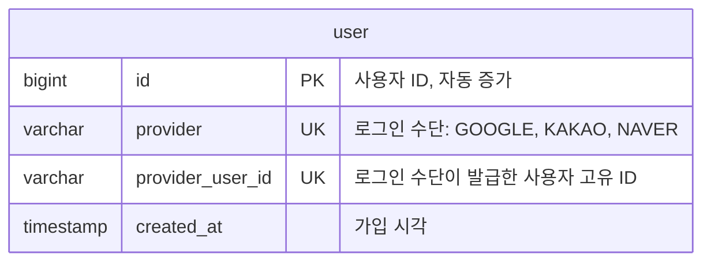
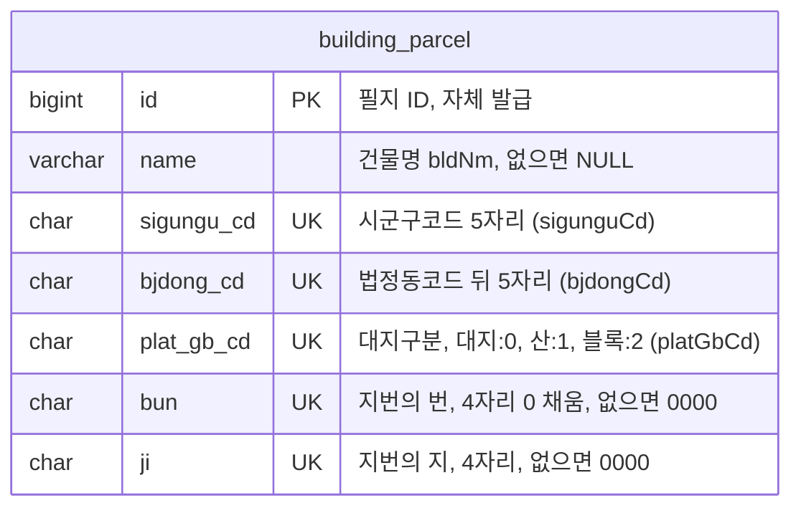

# Jipsee ERD

## user

> 사용자 정보

- UNIQUE(provider, provider_user_id): 로그인 수단별 별도 계정
- 탈퇴 시 행 삭제 (하드 삭제)

## building_parcel

> 필지

- UNIQUE(sigungu_cd, bjdong_cd, plat_gb_cd, bun, ji): 필지 식별을 위한 유니크 제약조건
- 예: 서울 종로구 부암동 208-13 = `11110`, `18400`, `0`, `0208`, `0013`
