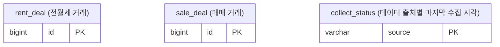
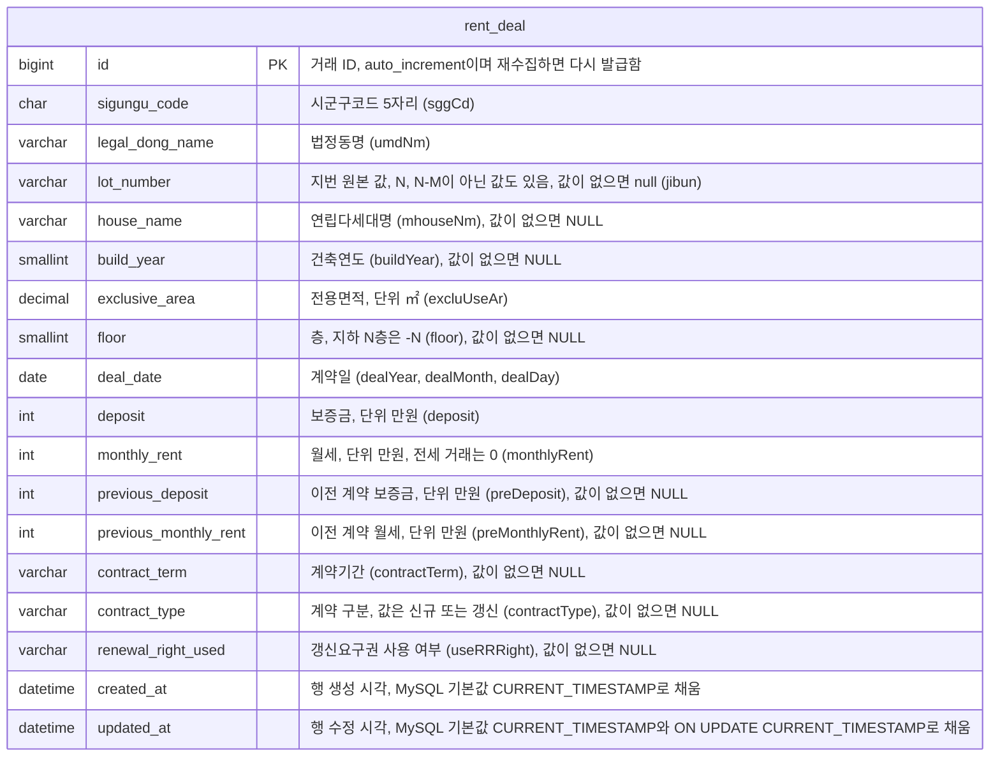
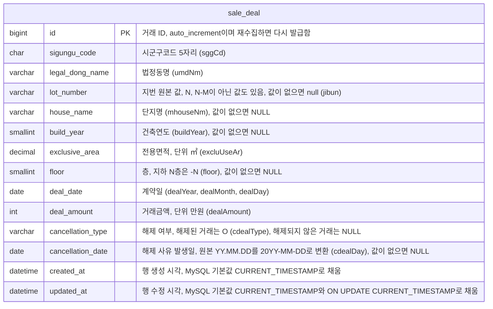
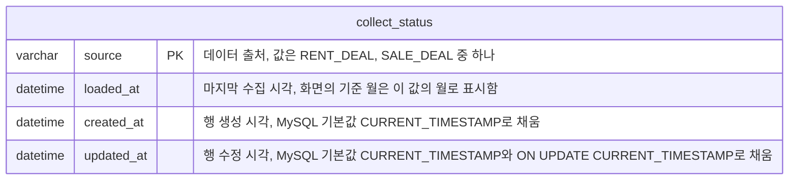

# Jipsee ERD

## 개요

- 모든 테이블에 created_at, updated_at을 둠. 두 컬럼은 MySQL 기본값으로 채우며, JPA 엔티티는 BaseEntity가 같은 값을 넣음

## 거래 묶음

> 같은 지번의 거래를 건물 하나로 보는 조회 단위. 테이블에 저장하지 않음

- 묶음 키는 (sigungu_code, legal_dong_name, lot_number)이며 어느 테이블에도 저장하지 않고 rent_deal과 sale_deal의 행에서 조회할 때 계산
- 묶음 id 문자열 형식은 `{sigungu_code}-{legal_dong_name}-{lot_number}`이며 예는 `11440-망원동-123-4`
- lot_number가 NULL인 거래는 묶음을 이루지 않으며 같은 법정동 주변 거래 조회에만 포함
- 묶음 이름은 묶음 안에서 계약일이 가장 늦은 거래의 house_name이며, 계약일이 같으면 rent_deal을 우선하고 그다음 id가 큰 행을 사용
- 지번 주소는 `{시군구명} {legal_dong_name} {lot_number}`이며 시군구명은 bjd.csv에서 조회
- building_parcel, building_register 테이블과 rent_deal, sale_deal의 building_parcel_id, match_status 컬럼은 스키마(`backend/schema`)에 남아 있으나 사용하지 않으며, 제거 여부는 별도 결정

## rent_deal

> 전월세 거래

- 유니크 제약을 두지 않음. 원본에 거래 ID가 없고 값이 같은 행이 있기 때문임
- INDEX(sigungu_code, deal_date)를 재수집할 때 삭제할 행을 찾는 데 사용함
- INDEX(sigungu_code, legal_dong_name, lot_number, deal_date) 추가 예정, 묶음의 거래 이력과 같은 법정동 주변 거래 조회에 사용. 새 버전 파일로 추가
- FULLTEXT(house_name) ngram 추가 예정, 연립다세대명 검색에 사용. 새 버전 파일로 추가

## sale_deal

> 매매 거래

- 유니크 제약을 두지 않음. 원본에 거래 ID가 없고 값이 같은 행이 있기 때문임
- INDEX(sigungu_code, deal_date)를 재수집할 때 삭제할 행을 찾는 데 사용함
- INDEX(sigungu_code, legal_dong_name, lot_number, deal_date) 추가 예정, 묶음의 거래 이력과 같은 법정동 주변 거래 조회에 사용. 새 버전 파일로 추가
- FULLTEXT(house_name) ngram 추가 예정, 단지명 검색에 사용. 새 버전 파일로 추가

## collect_status

> 데이터 출처별 마지막 수집 시각

- 데이터명, 제공 기관, 갱신 주기, 원본 링크는 변하지 않는 값이므로 저장하지 않음
