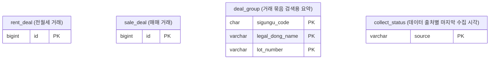
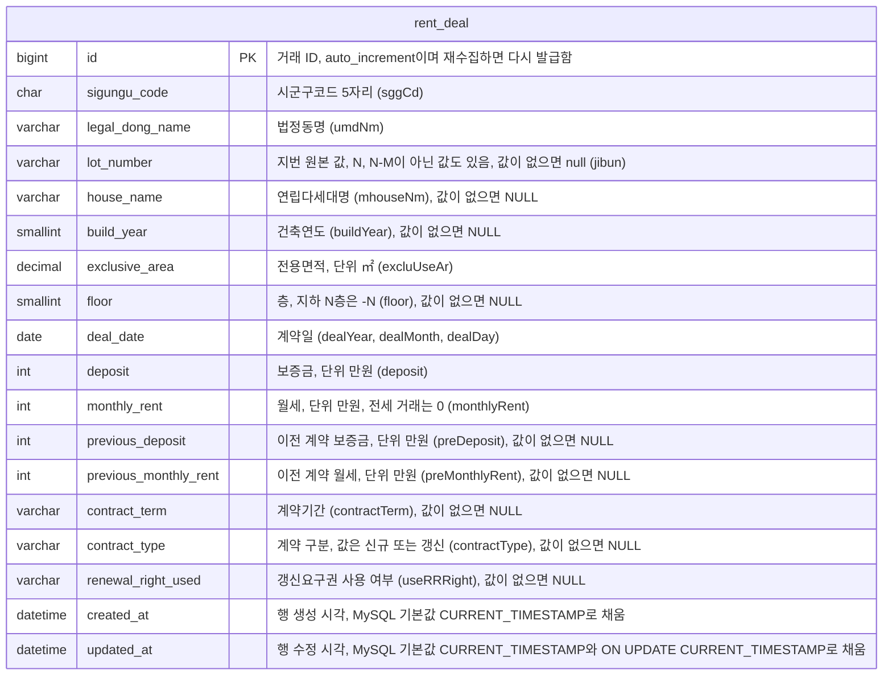
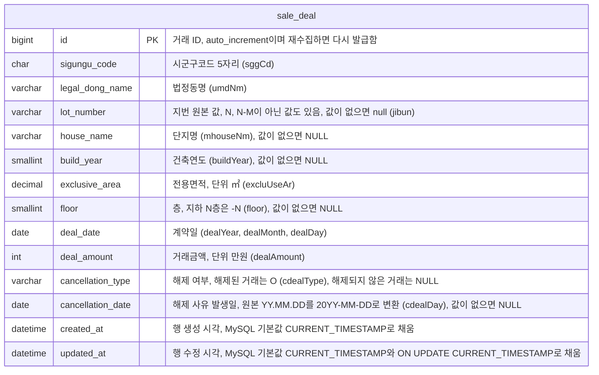
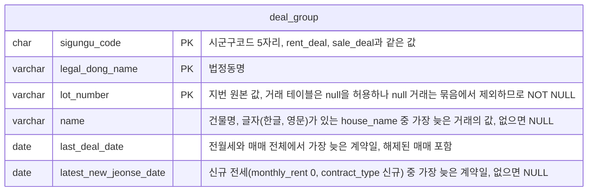
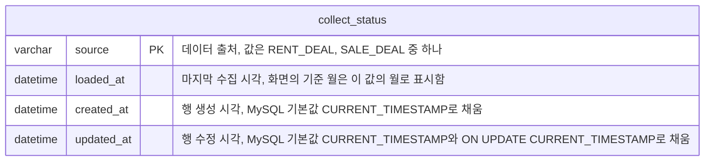

# Jipsee ERD

이 문서의 스키마는 V19 적용 뒤 기준

## 개요

- `rent_deal`, `sale_deal`, `collect_status`에 created_at, updated_at을 둠. 두 컬럼은 MySQL 기본값으로 채우며, JPA 엔티티는 BaseEntity가 같은 값을 넣음. `deal_group`은 매일 전체 재생성하는 파생 테이블이라 두지 않음

## 거래 묶음

> 같은 지번의 거래를 건물 하나로 보는 검색 단위. `deal_group`에 저장함

- 묶음 키는 (sigungu_code, legal_dong_name, lot_number)이며 검색 단위는 요약 테이블 `deal_group`에 저장함. `dailySaleCollectJob`의 `dealGroupRefreshStep`이 일일 수집 뒤 `deal_group_new`를 전체 재생성하고 `rename table`로 교체하므로 검색 결과는 최대 하루 늦게 반영됨(ADR 0010)
- `deal_group`의 컬럼과 인덱스는 아래 `deal_group` 절 참조
- 묶음 id 문자열 형식은 `{sigungu_code}-{legal_dong_name}-{lot_number}`이며 예는 `11440-망원동-123-4`
- lot_number가 NULL인 거래는 묶음을 이루지 않으며 같은 법정동 주변 거래 조회에만 포함
- 묶음 이름은 묶음 안에서 글자(한글, 영문)가 있는 house_name 중 계약일이 가장 늦은 거래의 값이며, 계약일이 같으면 rent_deal을 우선하고 그다음 id가 큰 행을 사용함. 글자 있는 이름이 없으면 NULL
- 지번 주소는 `{시군구명} {legal_dong_name} {lot_number}`이며 시군구명은 bjd.csv에서 조회

## rent_deal

> 전월세 거래

- 유니크 제약을 두지 않음. 원본에 거래 ID가 없고 값이 같은 행이 있기 때문임
- INDEX(sigungu_code, deal_date)를 재수집할 때 삭제할 행을 찾는 데 사용함
- INDEX(sigungu_code, legal_dong_name, lot_number, deal_date)를 묶음의 거래 이력, 같은 법정동 주변 거래 조회, `deal_group` 갱신 집계에 사용함(V17)
- FULLTEXT(house_name) ngram은 V17에서 추가했으나 검색이 `deal_group`으로 이동해 V19에서 삭제함

## sale_deal

> 매매 거래

- 유니크 제약을 두지 않음. 원본에 거래 ID가 없고 값이 같은 행이 있기 때문임
- INDEX(sigungu_code, deal_date)를 재수집할 때 삭제할 행을 찾는 데 사용함
- INDEX(sigungu_code, legal_dong_name, lot_number, deal_date)를 묶음의 거래 이력, 같은 법정동 주변 거래 조회, `deal_group` 갱신 집계에 사용함(V17)
- FULLTEXT(house_name) ngram은 V17에서 추가했으나 검색이 `deal_group`으로 이동해 V19에서 삭제함

## deal_group

> 거래 묶음 검색용 요약. 일일 수집 뒤 전체 재생성

- 외래 키를 두지 않음. 거래 테이블에서 매일 파생해 만드는 테이블이며 상세와 이력은 거래 테이블을 직접 조회함(ADR 0010)
- PRIMARY KEY(sigungu_code, legal_dong_name, lot_number)는 묶음 id의 구성 값과 같으며 지역 단독 검색에 접두사로 사용함. 별도 B-tree 인덱스는 없음
- FULLTEXT(name) ngram을 이름 단어 검색에 사용함(V18). 불용어 OFF 세션 값으로 인덱스를 생성하므로 `A동`, `in` 같은 단어도 검색됨
- 갱신은 `create table deal_group_new like deal_group`으로 만든 뒤 rent_deal과 sale_deal에서 `insert ... select`하고 `rename table`로 교체한 다음 이전 테이블을 삭제함. 이름은 테이블별 group by에서 계약일, 출처(rent_deal 우선), id를 고정 폭으로 이어 붙인 문자열의 max로 선택함

## collect_status

> 데이터 출처별 마지막 수집 시각

- 데이터명, 제공 기관, 갱신 주기, 원본 링크는 변하지 않는 값이므로 저장하지 않음
