# Jipsee ERD

## 개요

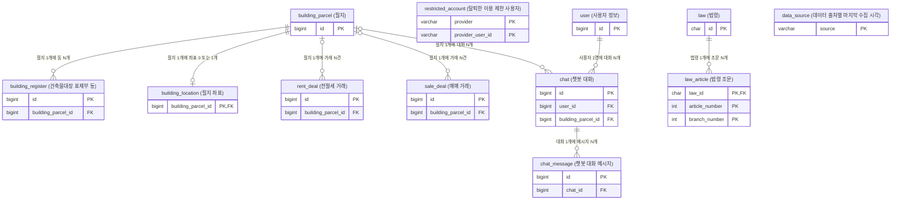

- 모든 테이블에 created_at, updated_at을 둠. 두 컬럼은 MySQL 기본값으로 채우며, JPA 엔티티는 BaseEntity가 같은 값을 넣음

## user

> 사용자 정보

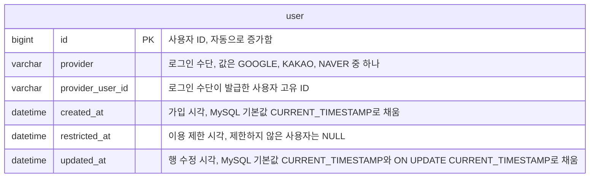

- UNIQUE(provider, provider_user_id)이며 provider_user_id는 대소문자를 구분함
- 탈퇴하면 행을 하드 삭제함
- 운영자가 이용을 제한하면 restricted_at에 시각을 기록하고, 제한을 풀면 NULL로 되돌림. 제한 사유는 로그에 남김

## restricted_account

> 탈퇴한 이용 제한 사용자. 재가입으로 제한을 피하지 못하게 60일 동안 보관함

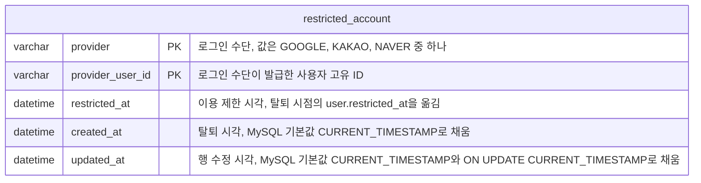

- 이용 제한된 사용자가 탈퇴하면 user 행을 삭제하기 전에 이 테이블에 행을 넣음
- 가입할 때 (provider, provider_user_id)가 이 테이블에 있으면 가입을 거부함
- 매일 한 번 created_at이 60일을 넘은 행을 삭제함

## building_parcel

> 필지

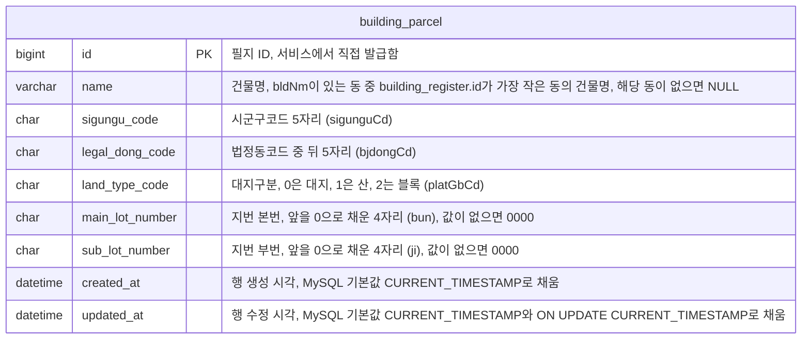

- UNIQUE(sigungu_code, legal_dong_code, land_type_code, main_lot_number, sub_lot_number)로 필지를 식별함
- 건축물 동이 모두 없어진 필지는 거래 FK가 참조하므로 삭제하지 않으며, 같은 지번에 동이 다시 생기면 같은 필지에 연결함
- 건축물 동이 모두 없어진 필지는 검색 결과와 S2에 나타나지 않음
- 예: 서울 종로구 부암동 208-13의 UNIQUE 컬럼 값은 `11110`, `18400`, `0`, `0208`, `0013`임

## building_register

> 건축물대장 표제부 동

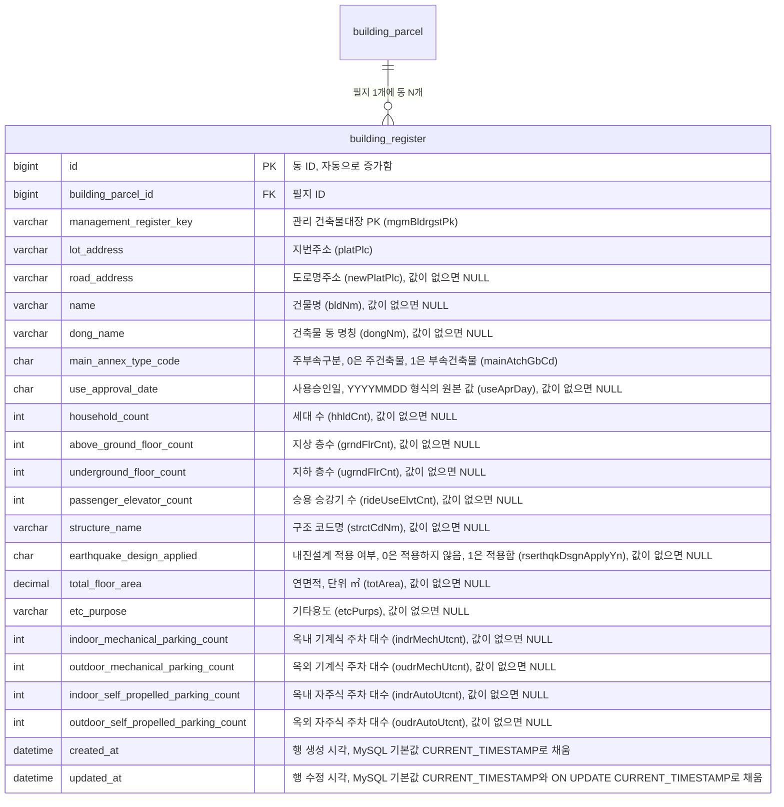

- UNIQUE(management_register_key)이며 월 적재의 기준 키임
- FULLTEXT(name, lot_address, road_address) ngram을 건물명, 지번주소, 도로명주소 검색에 사용함
- 건물명이 없는 필지는 주소로만 검색할 수 있음
- 동은 합치지 않고 동마다 1행으로 저장함

## building_location

> 필지 좌표

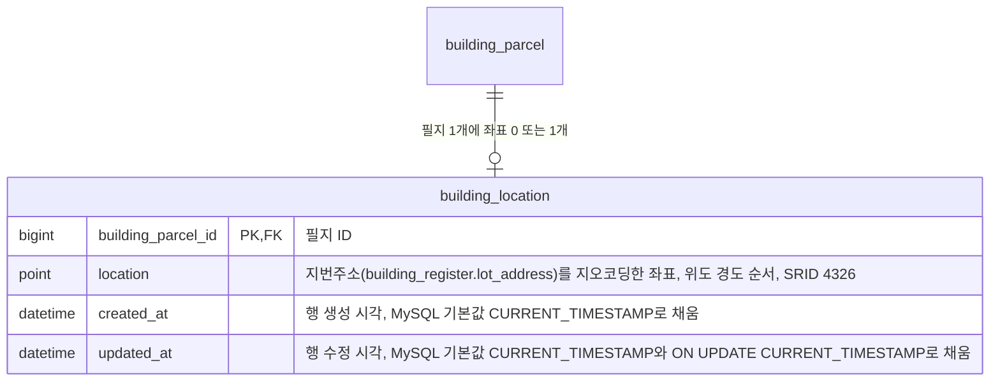

- SPATIAL INDEX(location)을 반경 검색에 사용함
- 지오코딩에 성공한 필지에만 행을 만들며, 행이 없는 필지는 표제부를 적재할 때마다 다시 지오코딩함

## rent_deal

> 전월세 거래

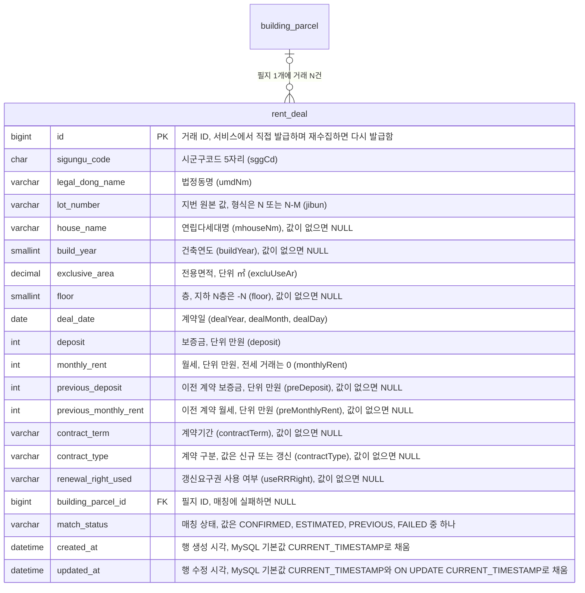

- CHECK: match_status가 FAILED일 때만 building_parcel_id가 NULL임
- 유니크 제약을 두지 않음. 원본에 거래 ID가 없고 값이 같은 행이 있기 때문임
- INDEX(sigungu_code, deal_date)를 재수집할 때 삭제할 행을 찾는 데 사용함
- INDEX(building_parcel_id, deal_date)를 필지의 거래 이력과 주변 거래 조회에 사용함

## sale_deal

> 매매 거래

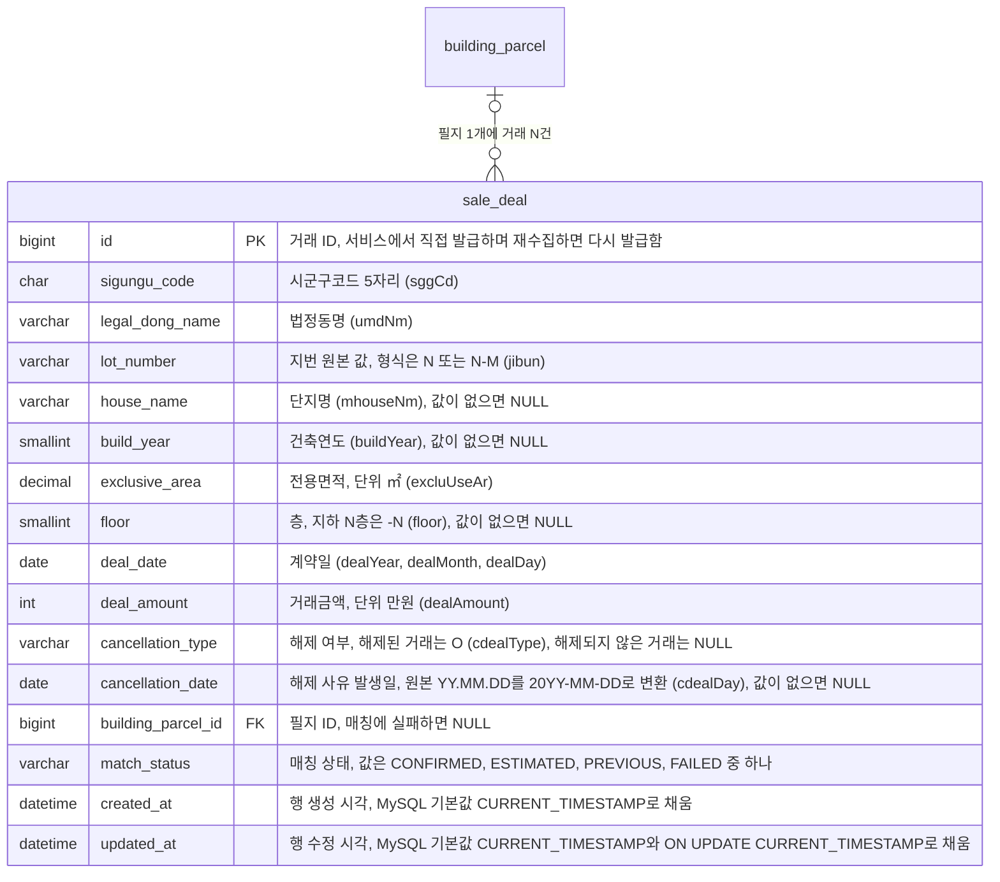

- CHECK: match_status가 FAILED일 때만 building_parcel_id가 NULL임
- 유니크 제약을 두지 않음. 원본에 거래 ID가 없고 값이 같은 행이 있기 때문임
- INDEX(sigungu_code, deal_date)를 재수집할 때 삭제할 행을 찾는 데 사용함
- INDEX(building_parcel_id, deal_date)를 필지의 거래 이력 조회에 사용함

## chat

> 챗봇 대화

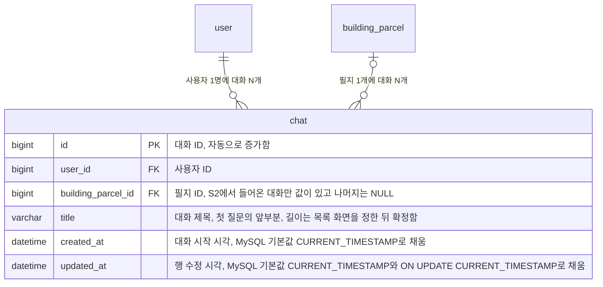

- 사용자가 삭제하거나 탈퇴할 때까지 보관함
- user_id FK에 ON DELETE CASCADE를 걸어, 탈퇴하면 대화도 함께 삭제함
- 대화 목록은 chat_message.id 최댓값의 역순으로 정렬함. id는 작성 순서대로 증가하고 chat_id 인덱스에 함께 저장되어 있어, 테이블 행을 읽지 않고 인덱스만으로 구할 수 있음

## chat_message

> 챗봇 대화 메시지

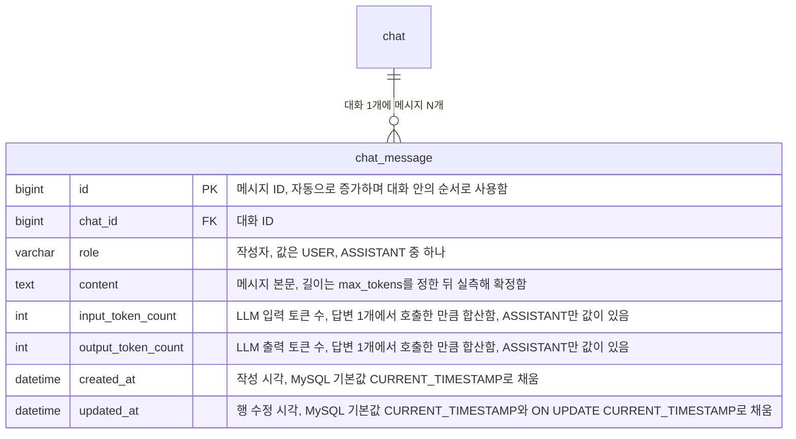

- chat_id FK에 ON DELETE CASCADE를 걸어, 대화를 삭제하면 메시지도 함께 삭제함
- 인덱스는 PK와 FK 인덱스만 둠. 대화의 메시지는 chat_id 인덱스로 찾고 id 순서로 정렬함

## law

> 법령

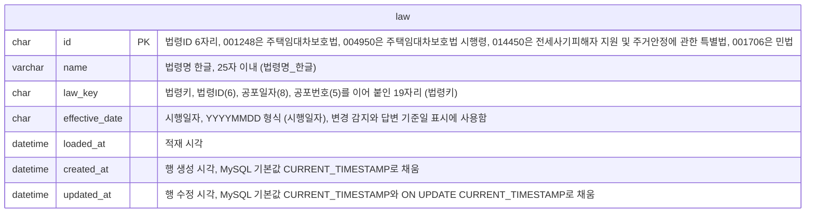

- 법령 4건을 고정으로 저장함
- 본문 응답에 법령일련번호가 없으므로 law_key를 변경 감지에 사용함

## law_article

> 법령 조문

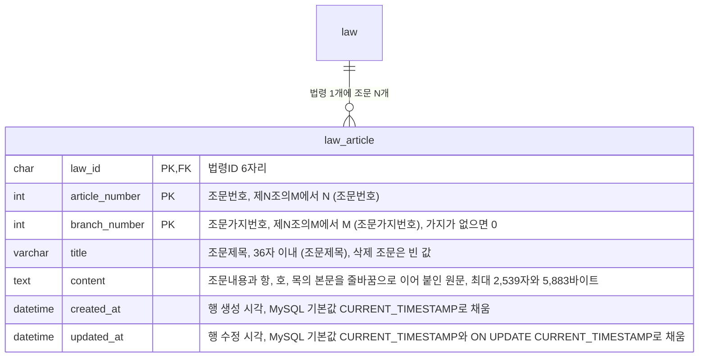

- FULLTEXT 인덱스를 두지 않음. 챗봇이 목차에서 조문을 골라 PK로 조회하기 때문임
- 조문여부가 조문인 행만 저장하며, 장과 절 같은 전문 행은 제외함
- 민법은 제618조부터 제654조까지만 저장함
- 삭제 조문은 민법 제651조처럼 원본 그대로 저장함
- API 응답의 law_key 또는 effective_date가 저장된 값과 다르면 해당 law_id의 law_article 행 전체를 삭제하고 다시 적재하며, law 갱신까지 한 트랜잭션으로 처리함
- 파싱한 조문이 0건이면 교체하지 않고 로그만 남김
- varchar 길이와 content 최대 길이는 2026-10-27 실측 최댓값 기준이며, varchar 길이를 초과하면 적재에 실패하고 로그를 남김

## data_source

> 데이터 출처별 마지막 수집 시각

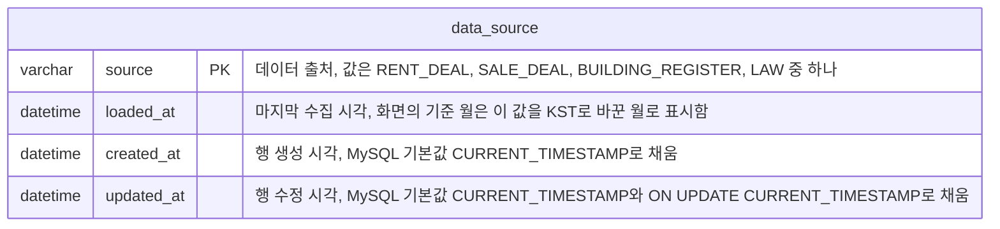

- 데이터명, 제공 기관, 갱신 주기, 원본 링크는 변하지 않는 값이므로 저장하지 않음
- LAW 행은 데이터 출처 카드에만 사용하며, 챗봇 답변의 기준일에는 law.effective_date를 사용함
