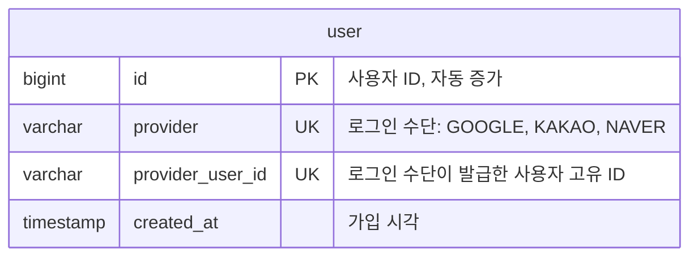
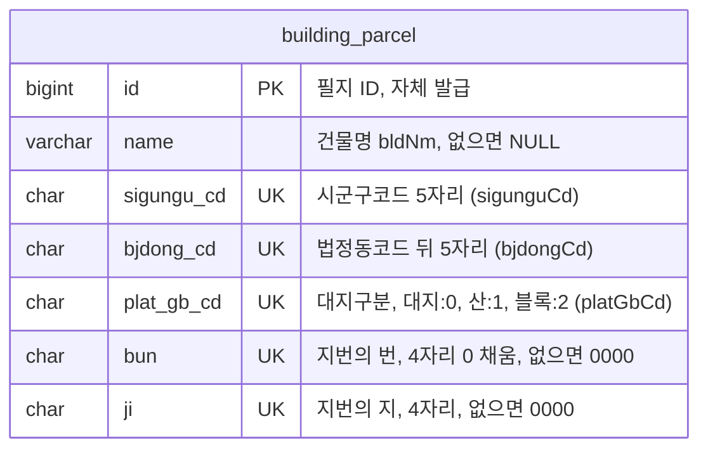
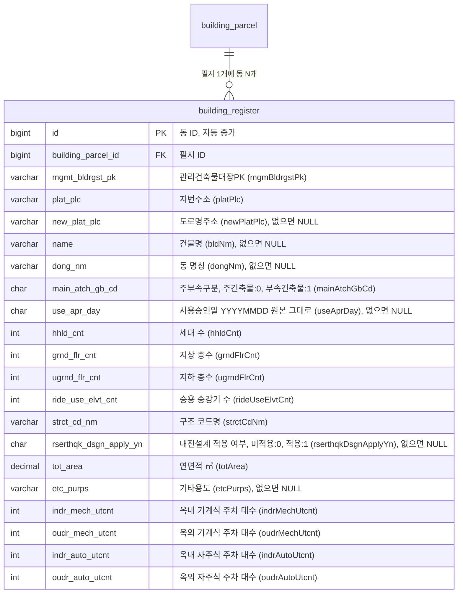

# Jipsee ERD

## user

> 사용자 정보

- UNIQUE(provider, provider_user_id): 로그인 수단별 별도 계정
- 탈퇴 시 행 삭제 (하드 삭제)

## building_parcel

> 필지

- UNIQUE(sigungu_cd, bjdong_cd, plat_gb_cd, bun, ji): 필지 식별을 위한 유니크 제약조건
- 예: 서울 종로구 부암동 208-13 = `11110`, `18400`, `0`, `0208`, `0013`

## building_register

> 건축물대장 표제부 동

- 필지 1개(building_parcel)에 동 N개(building_register): 1:N, 동은 원본 그대로 나열
- FULLTEXT(name, plat_plc, new_plat_plc) ngram: 건물명, 지번주소, 도로명주소 통합 검색
- 원본이 0인 수치 필드는 0으로 저장, 화면에서 숨김 (승강기는 0이면 "없음" 표시)
