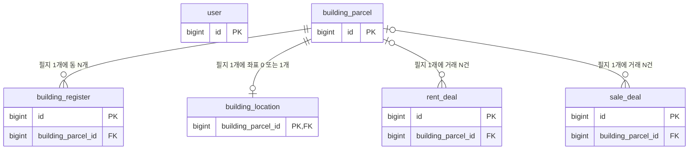
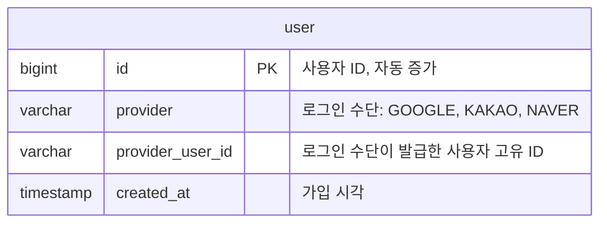
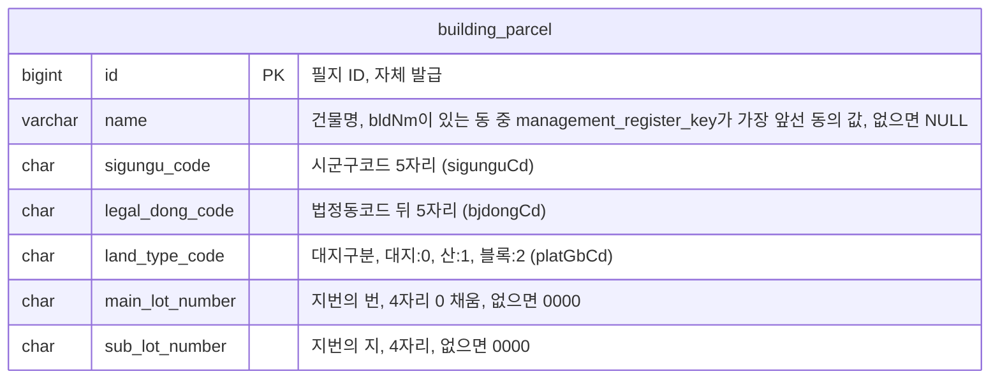
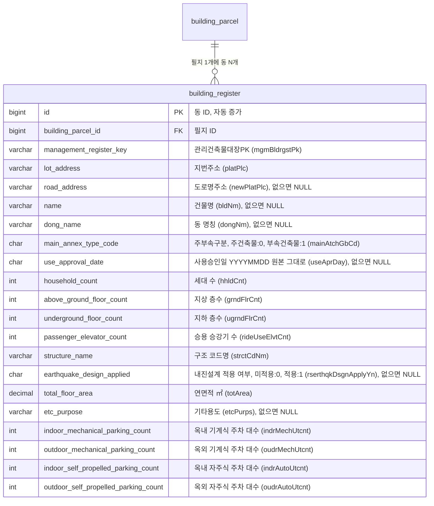
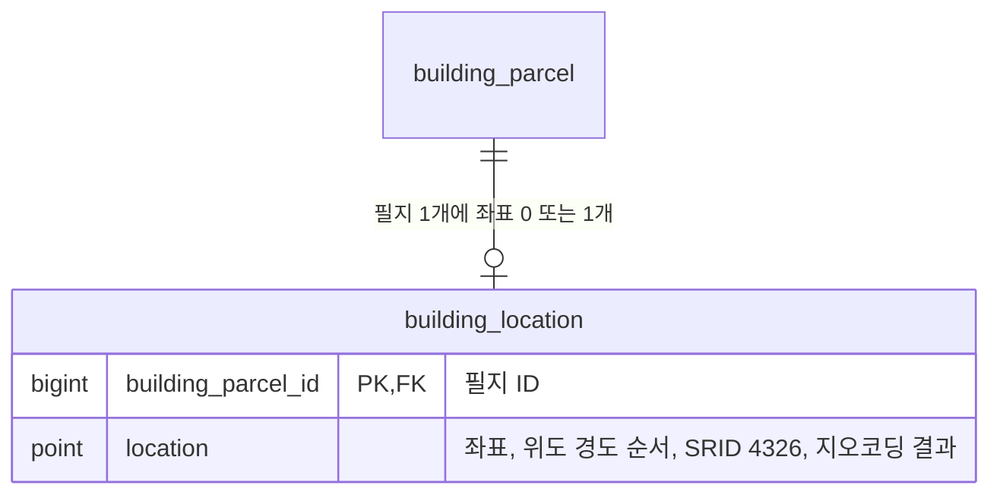
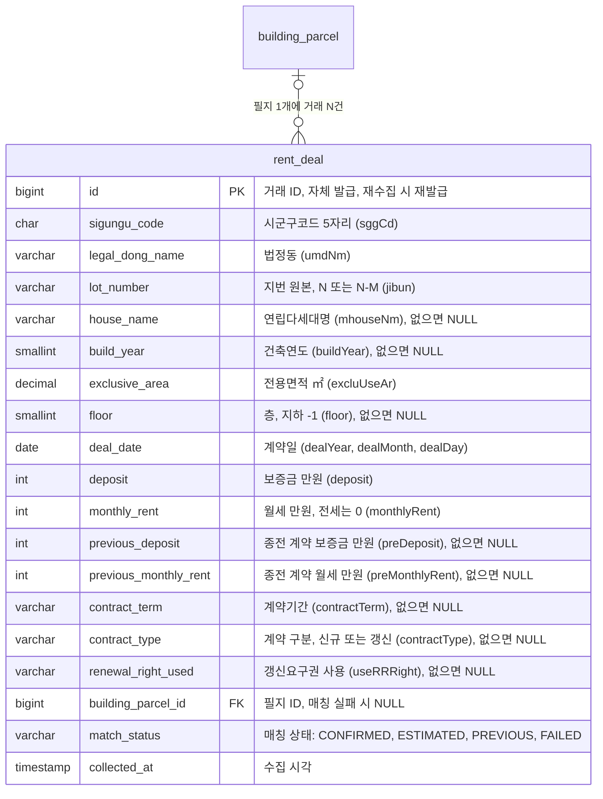
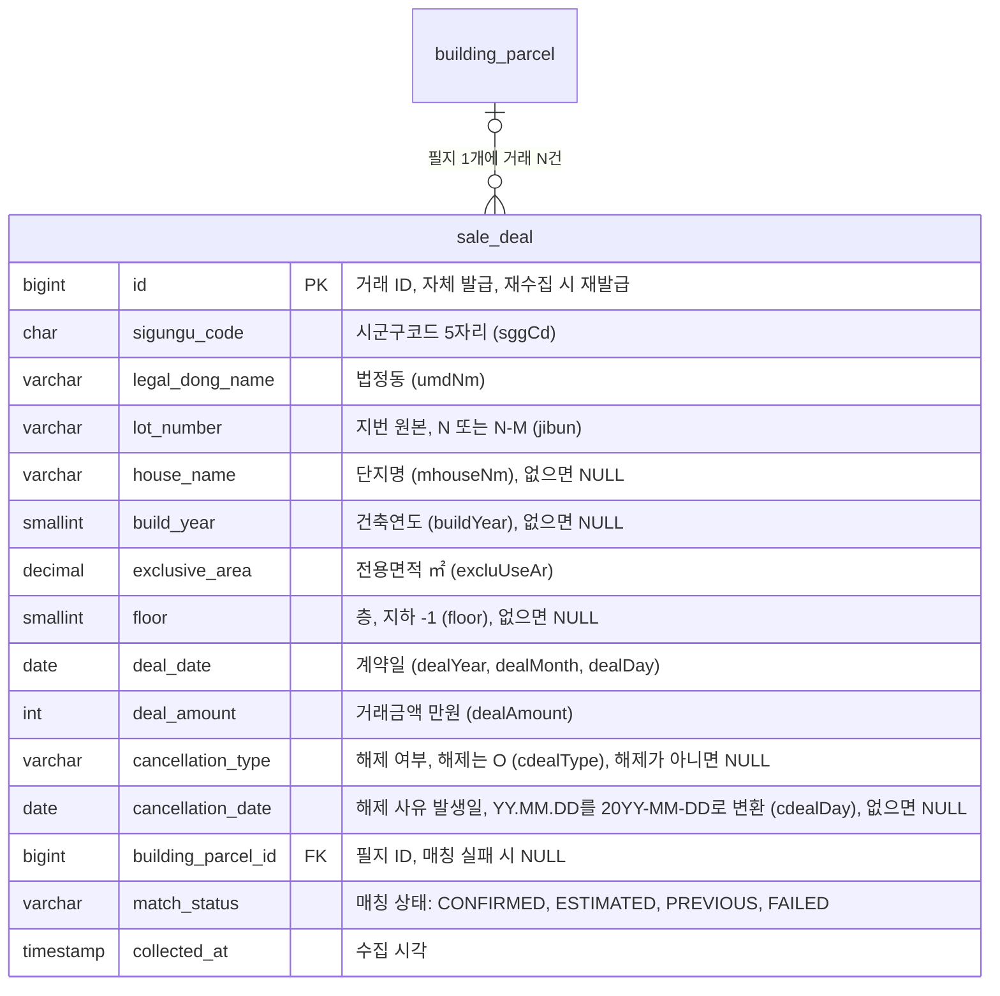
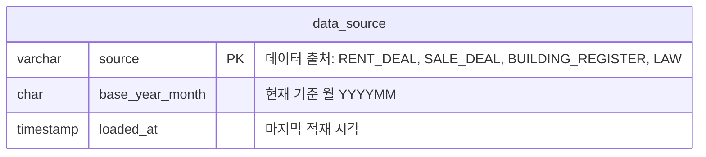

# Jipsee ERD

## 개요

## user

> 사용자 정보

- UNIQUE(provider, provider_user_id): 로그인 수단별 별도 계정, provider_user_id는 대소문자 구분
- 탈퇴 시 행 삭제 (하드 삭제)

## building_parcel

> 필지

- UNIQUE(sigungu_code, legal_dong_code, land_type_code, main_lot_number, sub_lot_number): 필지 식별을 위한 유니크 제약조건
- 예: 서울 종로구 부암동 208-13 = `11110`, `18400`, `0`, `0208`, `0013`

## building_register

> 건축물대장 표제부 동

- 필지 1개(building_parcel)에 동 N개(building_register): 1:N, 동은 원본 그대로 나열
- UNIQUE(management_register_key): 동 식별, 월 적재의 기준 키
- 적재 범위: 연립 또는 다세대 동이 있는 필지의 동 전부, 총괄표제부 제외
- FULLTEXT(name, lot_address, road_address) ngram: 건물명, 지번주소, 도로명주소 통합 검색
- 원본이 0인 수치 필드는 0으로 저장, 화면에서 숨김 (승강기는 0이면 "없음" 표시)

## building_location

> 필지 좌표

- PK가 FK: 필지당 좌표 1개
- 지오코딩에 성공한 필지만 행 생성
- SPATIAL INDEX(location): 주변 거래 반경 검색

## rent_deal

> 전월세 거래

- 필지 1개(building_parcel)에 거래 N건(rent_deal): 1:N, 매칭 실패 거래는 필지 없음
- CHECK: match_status가 FAILED일 때만 building_parcel_id가 NULL
- 유니크 제약 없음: 원본에 거래 ID가 없고 값이 같은 행이 존재
- 재수집: (sigungu_code, deal_date) 월 범위 삭제 후 재적재
- INDEX(sigungu_code, deal_date): 재수집 삭제
- INDEX(building_parcel_id, deal_date): 거래 이력, 주변 거래 조회

## sale_deal

> 매매 거래

- 필지 1개(building_parcel)에 거래 N건(sale_deal): 1:N, 매칭 실패 거래는 필지 없음
- CHECK: match_status가 FAILED일 때만 building_parcel_id가 NULL
- 유니크 제약 없음: 원본에 거래 ID가 없고 값이 같은 행이 존재
- 재수집: (sigungu_code, deal_date) 월 범위 삭제 후 재적재
- INDEX(sigungu_code, deal_date): 재수집 삭제
- INDEX(building_parcel_id, deal_date): 거래 이력 조회

## data_source

> 데이터 출처별 기준 월

- 다른 테이블과 관계 없음
- 화면의 기준일 표시와 데이터 출처 카드의 현재 기준 월에 사용
- 데이터명, 제공 기관, 갱신 주기, 원본 링크는 고정 값이라 저장하지 않음
