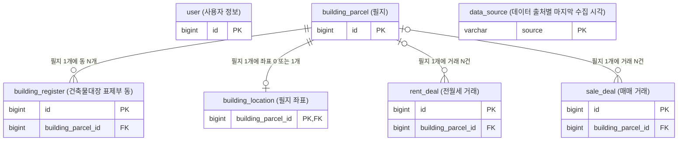
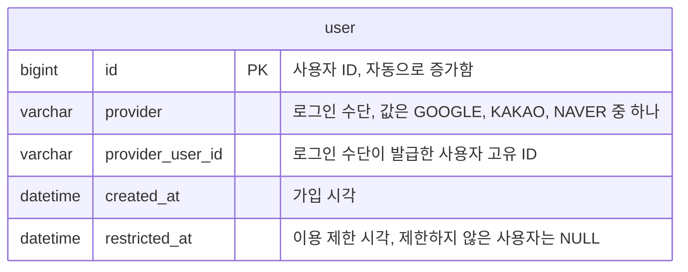
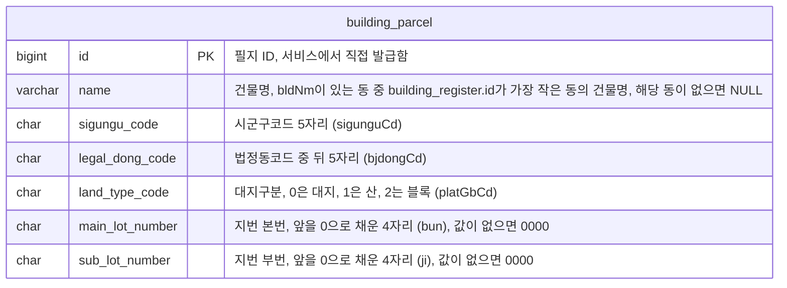
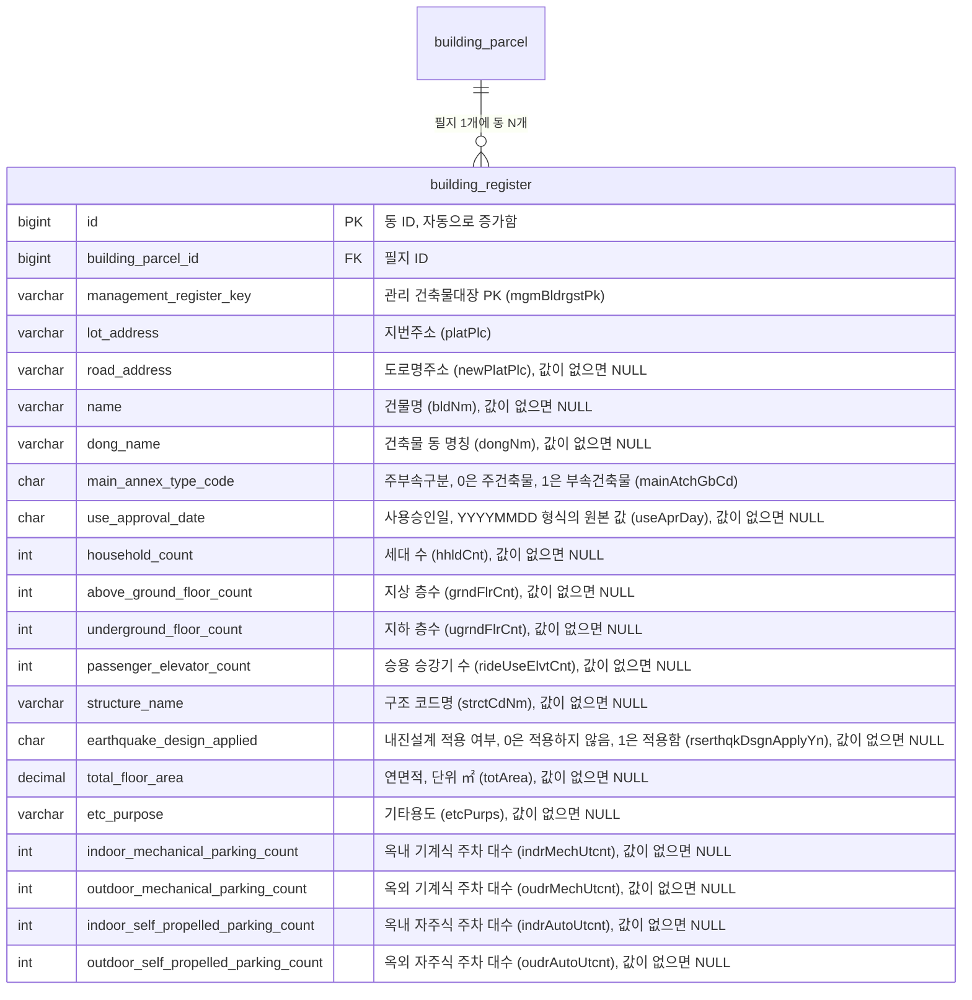
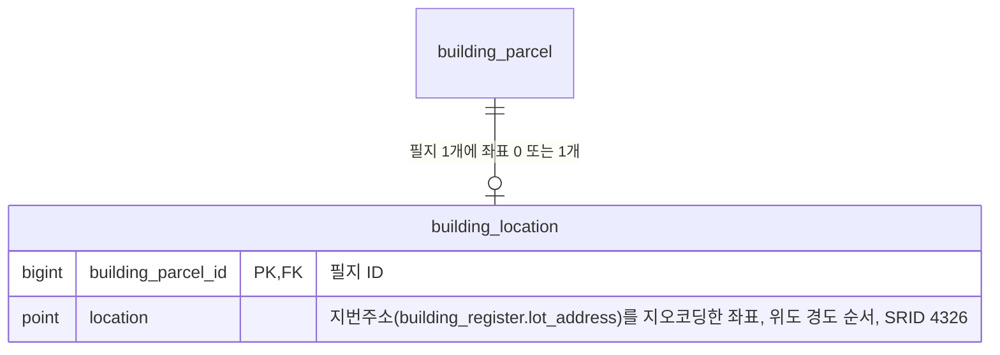
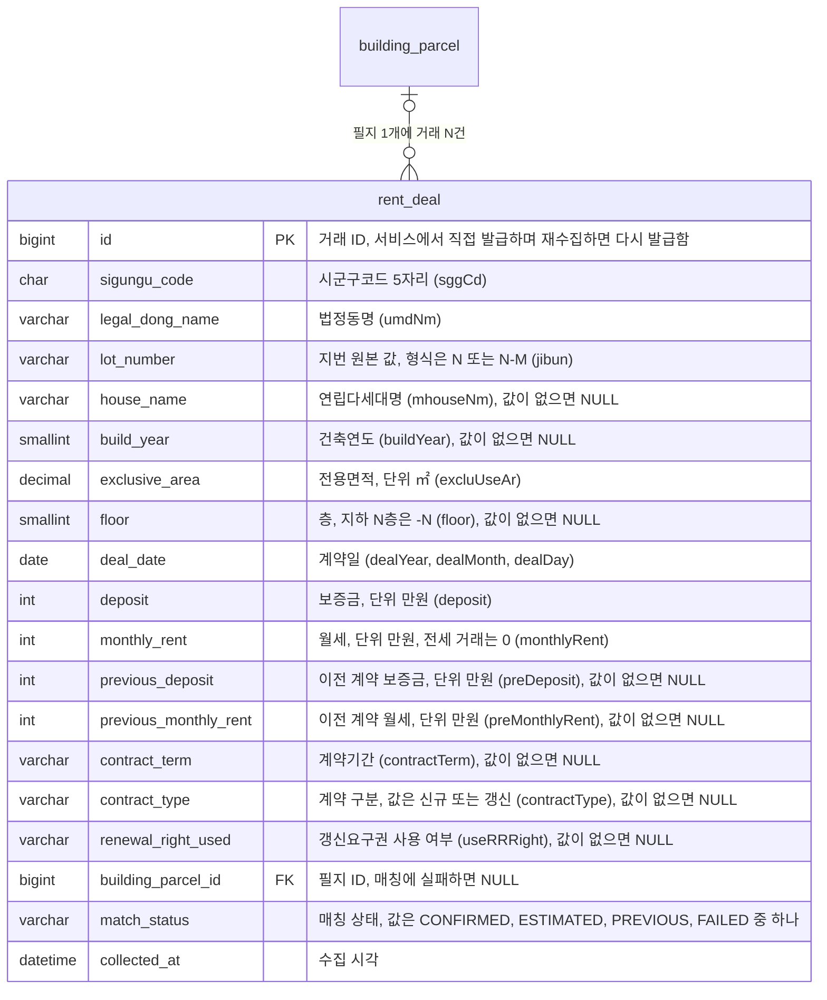
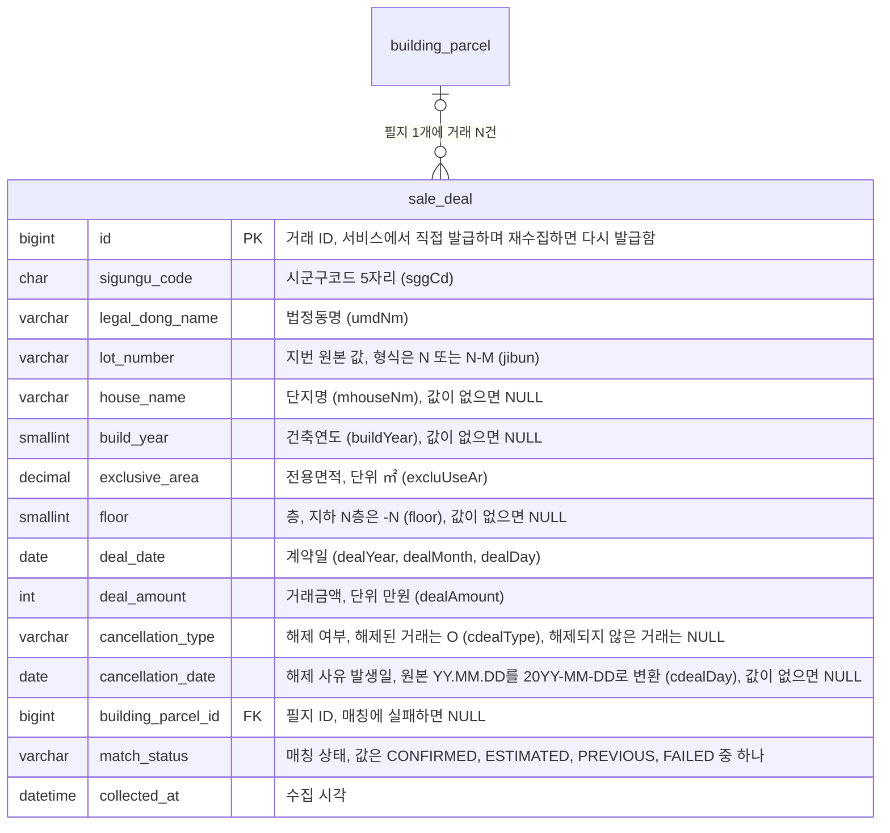
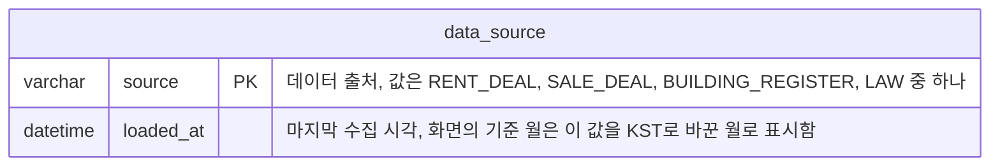

# Jipsee ERD

## 개요

## user

> 사용자 정보

- UNIQUE(provider, provider_user_id)이며 provider_user_id는 대소문자를 구분함
- 탈퇴하면 행을 하드 삭제함
- 운영자가 이용을 제한하면 restricted_at에 시각을 기록하고, 제한을 풀면 NULL로 되돌림. 제한 사유는 로그에 남김

## building_parcel

> 필지

- UNIQUE(sigungu_code, legal_dong_code, land_type_code, main_lot_number, sub_lot_number)로 필지를 식별함
- 건축물 동이 모두 없어진 필지는 거래 FK가 참조하므로 삭제하지 않으며, 같은 지번에 동이 다시 생기면 같은 필지에 연결함
- 건축물 동이 모두 없어진 필지는 검색 결과와 S2에 나타나지 않음
- 예: 서울 종로구 부암동 208-13의 UNIQUE 컬럼 값은 `11110`, `18400`, `0`, `0208`, `0013`임

## building_register

> 건축물대장 표제부 동

- UNIQUE(management_register_key)이며 월 적재의 기준 키임
- FULLTEXT(name, lot_address, road_address) ngram을 건물명, 지번주소, 도로명주소 검색에 사용함
- 건물명이 없는 필지는 주소로만 검색할 수 있음
- 동은 합치지 않고 동마다 1행으로 저장함

## building_location

> 필지 좌표

- SPATIAL INDEX(location)을 반경 검색에 사용함
- 지오코딩에 성공한 필지에만 행을 만들며, 행이 없는 필지는 표제부를 적재할 때마다 다시 지오코딩함

## rent_deal

> 전월세 거래

- CHECK: match_status가 FAILED일 때만 building_parcel_id가 NULL임
- 유니크 제약을 두지 않음. 원본에 거래 ID가 없고 값이 같은 행이 있기 때문임
- INDEX(sigungu_code, deal_date)를 재수집할 때 삭제할 행을 찾는 데 사용함
- INDEX(building_parcel_id, deal_date)를 필지의 거래 이력과 주변 거래 조회에 사용함

## sale_deal

> 매매 거래

- CHECK: match_status가 FAILED일 때만 building_parcel_id가 NULL임
- 유니크 제약을 두지 않음. 원본에 거래 ID가 없고 값이 같은 행이 있기 때문임
- INDEX(sigungu_code, deal_date)를 재수집할 때 삭제할 행을 찾는 데 사용함
- INDEX(building_parcel_id, deal_date)를 필지의 거래 이력 조회에 사용함

## data_source

> 데이터 출처별 마지막 수집 시각

- 데이터명, 제공 기관, 갱신 주기, 원본 링크는 변하지 않는 값이므로 저장하지 않음
