# Jipsee 화면 기획서

Oct 19, 2026 / @윤상준

관련 문서: [Jipsee 기획서 (PRD)](./prd.md), [Jipsee 기술 명세](./tech-spec.md)

## 1. 화면 목록

| 화면         | 진입                                                  |
| ------------ | ----------------------------------------------------- |
| S1 검색      | 첫 화면, 하단 내비게이션의 홈 탭(1280px 미만)         |
| S2 건물 상세 | S1의 검색 결과, 챗봇 답변에 나오는 건물 링크          |
| S3 챗봇      | S1의 하단 입력창, S2의 질문하기, 하단 내비게이션의 집사 탭(1280px 미만) |
| S4 로그인    | 헤더의 로그인(1280px 이상), 하단 내비게이션의 로그인 탭(1280px 미만), 로그인하지 않은 상태에서 챗봇에 들어감 |
| S5 내 정보   | 헤더의 내 정보 링크(1280px 이상), 하단 내비게이션의 내 정보 탭(1280px 미만) |
| S6 정책      | 푸터                                                  |

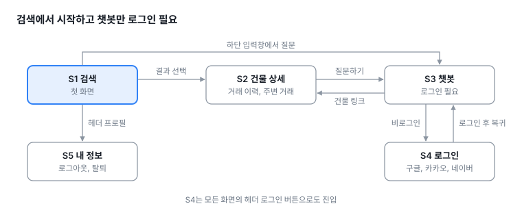

## 2. S1 검색

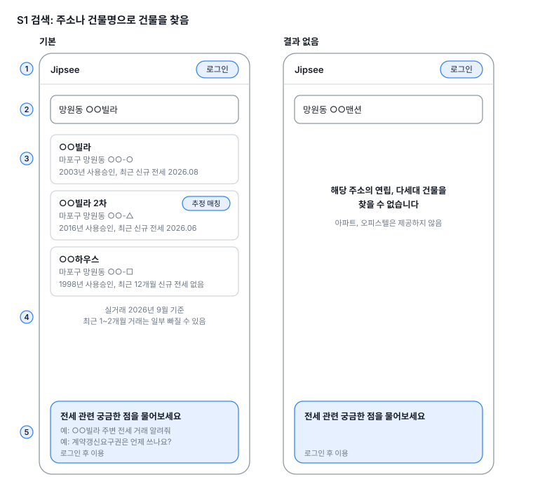

### 구성

| 번호 | 요소        | 내용                                                                                                               |
| ---- | ----------- | ------------------------------------------------------------------------------------------------------------------ |
| 1    | 헤더        | 로고와 서비스명 "집씨"를 표시함. 1280px 이상은 오른쪽에 계정 링크를 두며 로그인하지 않았으면 "로그인", 로그인했으면 "내 정보"를 표시함. 1280px 미만은 계정 링크를 두지 않고 하단 내비게이션이 대신함. 검색 결과의 모바일 헤더는 로고 왼쪽에 뒤로 가기를 두고 둘째 줄에 검색창을 둠. 검색 결과의 데스크톱은 제목 패널 위에 "홈으로" 링크를 둠. 헤더는 스크롤해도 화면 위에 고정함 |
| 2    | 검색창      | 도로명 주소, 지번 주소, 건물명을 입력함. 검색어가 비었거나 공백뿐이면 검색하지 않음. 검색어가 2자 미만이면 "검색어를 2자 이상 입력해 주세요"를 표시함 |
| 3    | 결과 목록   | 건물명(없으면 주소), 주소, 사용승인 연도, 최근 신규 전세 계약 월을 표시함. 최근 12개월 신규 전세가 없으면 모바일은 "최근 12개월 신규 전세 없음", 데스크톱은 "최근 12개월 없음"을 표시함. 결과를 누르면 S2로 이동함. 결과가 없으면 "해당 주소의 연립, 다세대 건물을 찾을 수 없어요"와 "아파트, 오피스텔은 제공하지 않아요"를 표시함 |
| 4    | 기준일      | 검색 전에는 안내 카드에, 결과가 있으면 검색창 근처 안내 상자에 "{기준 월} 실거래 정보까지 수집되어 있어요"와 "최근 1\~2개월 거래는 일부 빠져 있을 수 있어요"를 표시함. 결과가 없을 때 모바일은 표시하지 않음 |
| 5    | 챗봇 입력창 | 예시 질문을 표시하며 눌러도 동작하지 않음. 로그인하지 않았으면 "로그인하고 이용하기" 버튼을 표시하며 S4로 이동하고 로그인한 뒤 S3로 돌아옴. 로그인했으면 질문을 입력해 보내면 S3로 이동해 그 질문으로 대화를 시작하고, "지난 대화" 링크로 S3 대화 목록(`/chat/history`)에 들어갈 수 있음. 1280px 이상은 `/chat/history`가 `/chat`으로 이동하고 대화 목록은 S3의 왼쪽 레일에 표시함. 모바일은 홈에서 펼침 패널, 검색 결과에서 축소 바이고 데스크톱은 오른쪽 패널(폭 380)임 |

### 유저 플로우

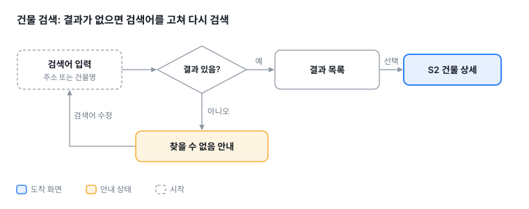

## 3. S2 건물 상세

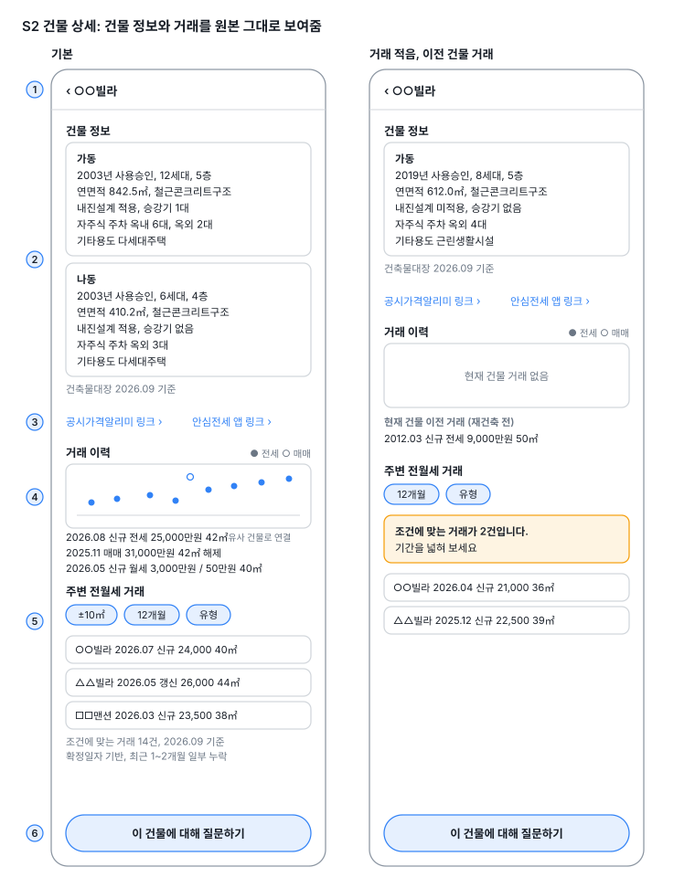

### 구성

| 번호 | 요소             | 내용                                                                                                                                                                                                                                                                                                                             |
| ---- | ---------------- | -------------------------------------------------------------------------------------------------------------------------------------------------------------------------------------------------------------------------------------------------------------------------------------------------------------------------------- |
| 1    | 헤더             | 1280px 미만은 로고 왼쪽에 뒤로 가기를 둔 로고 헤더이고, 건물명(없으면 주소)은 본문 첫 줄의 제목으로 표시함. 1280px 이상은 로고 헤더 아래 본문 첫 줄에 뒤로 가기와 건물명(없으면 주소)을 표시하고, 건물명이 있으면 주소도 함께 표시함. 뒤로 가기는 이전 화면으로 돌아감 |
| 2    | 건물 정보        | 동마다 동 명칭(있을 때만), 사용승인 연도, 세대수, 층수, 연면적, 구조, 내진설계, 승강기, 주차 대수, 기타용도를 표시하고, 건축물대장 기준 월을 표시함. 사용승인, 세대수, 층수, 연면적, 구조, 기타용도는 값이 없거나 0이면 숨김. 내진설계는 적용 여부가 없으면 숨기고, 적용이면 "적용", 적용하지 않음이면 "미적용"을 표시함. 승강기는 값이 없으면 숨기고 0이면 "없음"을 표시함. 주차 대수는 옥내와 옥외 중 0이거나 없는 쪽을 빼고 표시하며 둘 다 없으면 숨김 |
| 3    | 외부 링크        | 공시가격알리미 링크와 안심전세 앱 링크를 표시하며 새 탭으로 열림 |
| 4    | 거래 이력        | 계약 월별 점 그래프와 거래 목록을 표시함. 그래프 범례에 전세, 매매, 갱신, 해제, 유사 건물, 이전 건물을 표시하고 "월세는 목록에서 확인해요"를 안내함. 월세의 보증금과 월세는 그래프에 그리지 않고 거래 목록에만 표시함. 금액은 1억 이상이면 "1억 8,000만원"처럼 억 단위로 표시함. 현재 건물 거래가 없으면 그래프에 "현재 건물 거래가 없어요"를 표시하고 목록을 두지 않음. 재건축 전 건물의 거래가 있으면 현재 건물 거래 목록 아래에 "이전 건물 거래" 블록을 따로 표시함 |
| 5    | 주변 전월세 거래 | 반경은 300m, 500m, 1km 중에서 고르며 기본값은 500m임. 기간은 6개월, 12개월, 24개월 중에서 고르며 기본값은 12개월임. 거래 유형은 전세와 월세 중에서 고르며 기본값은 전세임. 세 조건은 선택 상자로 고르고, 고르면 새 조건으로 다시 조회함. 면적 조건은 현재 건물 거래(이전 건물 거래 제외)의 전용면적 최솟값보다 10㎡ 작은 값부터 최댓값보다 10㎡ 큰 값까지로 고정하며, 사용자가 바꿀 수 없음. 면적 조건을 적용했을 때만 "이 건물 거래 면적 ±10㎡로 고정돼요"를 표시하고, 현재 건물 거래가 없으면 면적 조건 없이 조회함. 조건에 맞는 거래 건수를 "조건에 맞는 거래 N건을 찾았어요"로 실거래 기준 월과 함께 표시함. 건수가 3건 미만이면 건수와 "반경이나 기간을 넓혀 보세요"를 담은 안내 상자를 함께 표시하고, 0건이면 안내 상자 제목이 "조건에 맞는 거래가 없어요"임. 월세 거래에는 보증금과 월세를 표시함. 맨 아래에 "확정일자를 기준으로 수집한 거래예요. 최근 1\~2개월 거래는 일부 빠져 있을 수 있어요"를 표시함. 건물 좌표가 없으면 위 내용 없이 "이 건물은 위치 정보가 없어서 주변 거래를 보여드릴 수 없어요"만 표시함 |
| 6    | 질문하기         | "이 건물에 대해 질문하기" 버튼을 1280px 미만은 화면 아래 바(푸터 위)에, 1280px 이상은 오른쪽 열 맨 위 카드에 표시함. 누르면 해당 건물로 새 대화를 시작하는 S3로 이동함. 로그인하지 않았으면 S4로 이동하고 로그인한 뒤 S3로 돌아옴. 로그인 안내 문구와 아이콘은 두지 않음 |

### 유저 플로우

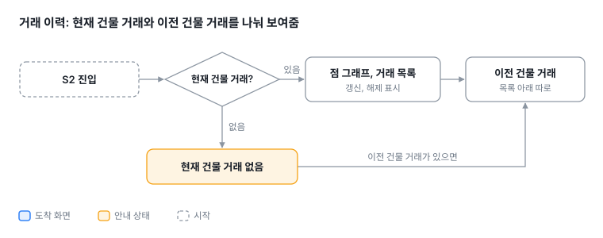

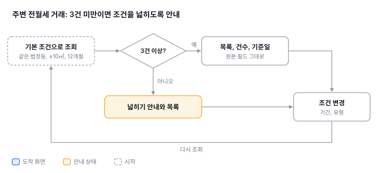

## 4. S3 챗봇(집사)

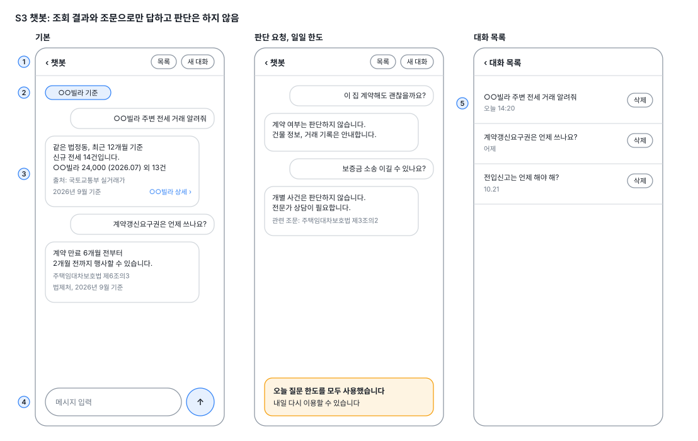

### 구성

| 번호 | 요소        | 내용                                                                                                                                                                                             |
| ---- | ----------- | ------------------------------------------------------------------------------------------------------------------------------------------------------------------------------------------------ |
| 1    | 헤더, 도구줄 | 헤더는 다른 화면과 같은 뒤로 가기와 로고임. 모바일과 태블릿(1280px 미만)은 헤더 아래 도구줄에 제목 "집사", 대화 목록 버튼, 새 대화 버튼을 표시함. 데스크톱(1280px 이상)은 대화 영역 왼쪽의 대화 목록 레일 맨 위에 제목 "집사"와 새 대화 버튼을 표시하고 대화 목록 버튼은 두지 않음 |
| 2    | 건물 칩     | S2에서 들어오면 해당 건물로 새 대화를 시작하며, 도구줄 아래에 "{건물명} 기준" 칩을 표시함. 칩은 표시만 하고 누르거나 지울 수 없음. 이름이 없는 건물은 주소를 표시함                               |
| 3    | 대화        | 빈 대화는 제목과 예시 질문 버튼을 표시하며 예시 질문을 누르면 입력에 채우기만 함. 답변은 첫 글자가 오기 전 점 세 개를 보이고, 글자가 오면 이어 붙이며 끝에 커서를 둠. 답변에 출처와 기준일, 답변에 나온 건물의 상세 링크를 표시함 |
| 4    | 입력창      | 답변이 나오는 중에는 보내기 버튼만 막고 입력은 쓸 수 있음. Enter로 전송함. 일일 한도를 모두 사용했으면 입력창 자리에 한도 안내를 표시함                                                          |
| 5    | 대화 목록   | 모바일과 태블릿은 `/chat/history`에, 데스크톱은 대화 영역 왼쪽 레일(폭 296)에 지난 대화의 제목과 마지막 메시지 시각을 최근 순으로 표시함. 대화를 누르면 `/chat/{id}`로 이동해 이전 메시지를 불러오고 이어서 질문할 수 있음. 지금 보는 대화는 레일에서 흰 바탕과 굵은 제목으로 표시하고, 새 대화이면 새 대화 버튼을 파란 테두리로 표시함. 새 대화는 답변이 끝난 뒤에 레일에 나타남. 확인 창을 거친 뒤 대화를 삭제할 수 있음. 데스크톱 레일에서 지금 보는 대화가 아닌 대화를 삭제하면 화면은 그대로 두고 항목만 빼며, 지금 보는 대화를 삭제하면 새 대화로 이동함. 데스크톱에서 `/chat/history`를 열면 `/chat`으로 이동함 |

### 유저 플로우

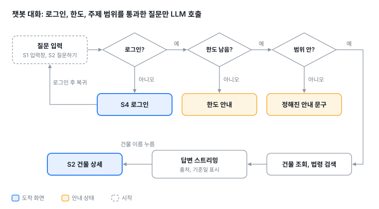

## 5. S4 로그인, S5 내 정보

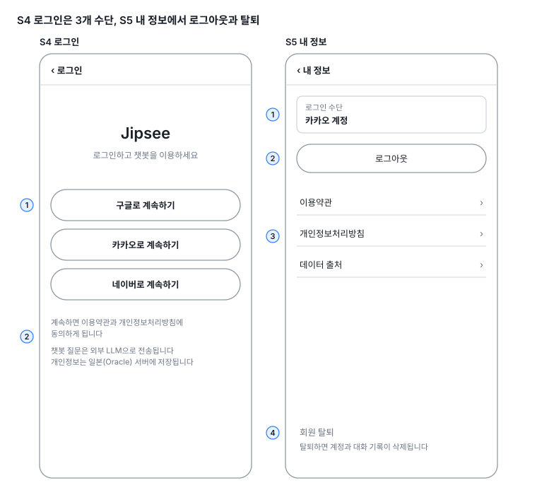

### S4 로그인

| 번호 | 요소        | 내용                                                                                                                  |
| ---- | ----------- | --------------------------------------------------------------------------------------------------------------------- |
| 1    | 로그인 버튼 | "구글로 계속하기", "카카오로 계속하기", "네이버로 계속하기"를 표시함. 누르면 해당 제공자의 로그인으로 이동하고, 로그인하면 로그인 링크를 누르기 전에 보던 화면으로 돌아감 |
| 2    | 안내        | 로고 "집씨"와 "로그인하고 챗봇을 이용해 보세요"를 표시함. 모바일은 헤더에 제목이 없으므로 본문의 "집씨"가 제목임 |
| 3    | 실패 안내   | 로그인에 실패하거나 취소하면 "로그인하지 못했어요. 다시 시도해 주세요"를 표시함. 실패와 취소는 구분하지 않음 |
| 4    | 접근        | 이미 로그인한 상태로 들어오면 S1로 이동함 |

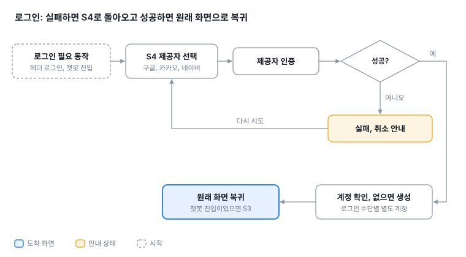

### S5 내 정보

| 번호 | 요소        | 내용                                                  |
| ---- | ----------- | ----------------------------------------------------- |
| 1    | 로그인 수단 | 현재 로그인한 제공자를 "구글 계정", "카카오 계정", "네이버 계정" 중 하나로 표시함 |
| 2    | 로그아웃    | 로그아웃하면 S1로 이동함                              |
| 3    | 회원 탈퇴   | "회원 탈퇴"를 누르면 "탈퇴할까요?" 확인 창이 열림. "탈퇴하기"를 누르면 계정과 대화 기록을 삭제하고 S1로 이동하며, "취소"는 창을 닫음. 확인 창은 1280px 미만은 바텀시트, 이상은 대화상자임. 버튼 아래에 "탈퇴하면 계정과 대화 기록이 삭제돼요"를 표시함 |
| 4    | 접근        | 로그인하지 않은 상태로 들어오면 S4로 이동하고 로그인한 뒤 S5로 돌아옴. 모바일은 헤더에 제목이 없으므로 본문 첫 줄의 "내 정보"가 제목임 |

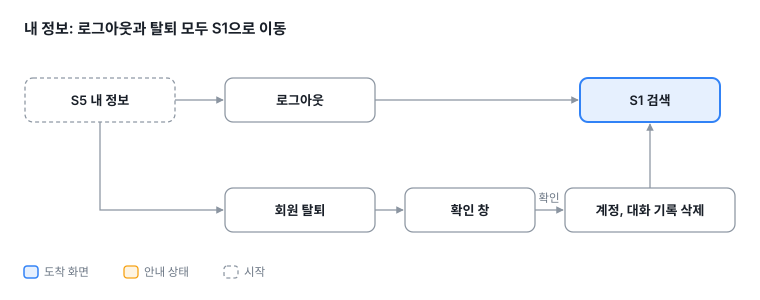

## 6. S6 정책

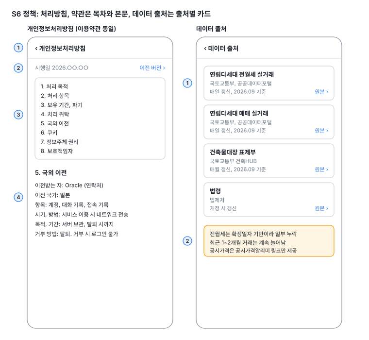

### 구성

| 번호          | 요소      | 내용                                                                                               |
| ------------- | --------- | -------------------------------------------------------------------------------------------------- |
| 1             | 헤더      | 로고 헤더이며 1280px 미만은 로고 왼쪽에 뒤로 가기를 둠. 문서명은 본문 첫 줄 제목으로 표시함 |
| 2             | 시행일    | 시행일을 표시함. 첫 버전이라 이전 버전 링크는 숨기고, 이전 버전이 생기면 표시함 |
| 3             | 목차      | 이용약관과 개인정보처리방침에 표시하며, 목차의 항목을 누르면 본문의 해당 항목으로 이동함 |
| 4             | 본문      | 항목별 내용을 표시함                                                                               |
| 5             | 임시 초안 안내 | 본문이 법률 검토 전의 임시 초안이라 이용약관과 개인정보처리방침은 제목 아래에 "이 문서는 임시로 작성한 초안입니다. 정식 문서가 게시되기 전까지 내용이 바뀔 수 있습니다."를, 데이터 출처는 "임시로 적은 안내예요. 정식 안내가 나오면 내용이 바뀔 수 있어요"를 표시함. 정식 문서로 바꿀 때 삭제함 |
| 데이터 출처 1 | 출처 카드 | 연립다세대 전월세 실거래, 연립다세대 매매 실거래, 건축물대장 표제부 카드 세 장을 표시함. 카드마다 데이터명, 제공 기관, "{주기} 갱신, {YYYY.MM} 기준", 원본 링크(새 탭)를 표시함. 법령 카드는 2단계에서 표시함 |
| 데이터 출처 2 | 한계 안내 | 확정일자 기반이라 거래가 누락될 수 있고, 공개가 늦어 나중에 나타나는 거래가 있을 수 있으며, 공시가격은 직접 보여 주지 않고 부동산공시가격 알리미 링크만 제공함을 안내함 |

### 유저 플로우

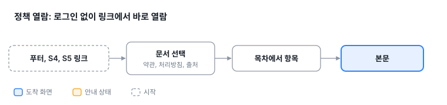

### 개인정보처리방침 항목

| 항목             | Jipsee 내용                                                                                                                       |
| ---------------- | --------------------------------------------------------------------------------------------------------------------------------- |
| 처리 목적        | 회원 식별, 챗봇 제공, 요청 제한, 부정 이용 방지                                                                                   |
| 처리 항목        | 로그인 제공자(구글, 카카오, 네이버), 제공자 사용자 ID, 가입 시각, 챗봇 대화 내용, 대화 대상으로 고른 건물, 접속 IP, 접속 기록, 로그인 세션 쿠키, 이용 제한 시각. 이름, 이메일, 전화번호, 생년월일, 프로필 사진은 수집하지 않음. 챗봇 대화 내용은 외부 LLM으로 전송하며 모델 학습에 쓰지 않음 |
| 보유 기간, 파기  | 계정은 탈퇴할 때까지 보관함. 대화 기록은 사용자가 삭제하거나 탈퇴할 때까지 보관함. 접속 기록의 보관 기간은 미정임. 탈퇴하면 즉시 삭제하고, 백업에 남은 정보는 7일 뒤 삭제함. 이용 제한된 사용자가 탈퇴하면 재가입으로 제한을 피하지 못하게 로그인 식별자와 제한 시각을 60일 보관한 뒤 삭제함 |
| 처리 위탁        | Oracle(서버, 데이터베이스, 백업), Anthropic, PBC(챗봇 답변 생성), Cloudflare(CDN, 봇 차단, 2단계), Sentry(오류 추적, 2단계). 개인정보를 제3자에게 제공하지 않음 |
| 국외 이전        | 이전받는 자별로 법적 근거(개인정보 보호법 제28조의8 제1항 제3호 가목), 이전 국가, 항목, 시기와 방법, 목적과 보유 기간, 거부 방법과 효과, 연락처를 기재함. Oracle은 일본, Anthropic은 미국이며 Cloudflare와 Sentry는 확정 전임 |
| 쿠키             | 로그인 세션 쿠키를 사용함. 쿠키를 거부하면 로그인할 수 없음                                                                       |
| 정보주체 권리    | 열람, 정정, 삭제, 처리정지를 요청하는 방법을 기재함. 탈퇴는 S5에서, 대화 삭제는 S3에서 할 수 있음. 그 밖의 요청은 보호책임자 이메일로 받고 10일 안에 처리 결과를 알림. 챗봇의 부적절한 답변 신고 방법과 침해 신고 기관(개인정보침해신고센터, 개인정보분쟁조정위원회)을 안내함 |
| 안전성 확보 조치 | HTTPS, 서버 접근 제한, 비밀값 분리                                                                                                |
| 보호책임자       | 성명, 이메일, 연락처. 실제 값이 정해지기 전에는 "[임시]" 자리 표시 문구를 표시함 |
| 변경             | 시행일을 기재하고 이전 버전을 보관함                                                                                              |

### 이용약관 항목

| 항목        | Jipsee 내용                                                                                       |
| ----------- | ------------------------------------------------------------------------------------------------- |
| 서비스 내용 | 공공데이터 조회와 챗봇을 제공함. 계산, 판단, 법률 자문은 제공하지 않음. 무료로 제공하며 점검 등으로 일시 중단할 수 있음 |
| 회원        | 구글, 카카오, 네이버 로그인으로 가입함. 탈퇴는 S5에서 할 수 있음                                  |
| 이용 제한   | 자동화 수집, 요청 제한 초과, 지시 조작 시도가 있으면 이용을 제한함. 제한 사실과 사유를 알리고, 이의가 있으면 소명할 수 있음 |
| 데이터 한계 | 원본을 그대로 제공하며 정확성과 완전성을 보증하지 않음. 누락이나 공개 지연이 있을 수 있고, 유사 건물로 연결된 거래가 포함될 수 있음. 기준 월은 해당 데이터를 마지막으로 수집한 달임 |
| 챗봇        | 로그인한 회원에게 제공함. 답변은 일반 정보이며 법률 자문이 아님. 외부 LLM(Anthropic, PBC)을 사용함. 일일 한도가 있고 넘으면 다음 날 이용할 수 있음 |
| 책임        | 무료 서비스임. 고의 또는 중대한 과실이 없으면 정보 이용 결과, 공공데이터 원본의 오류, 외부 서비스 장애로 생긴 손해에 책임지지 않음 |
| 변경, 분쟁  | 변경하면 적용일 7일 전(이용자에게 불리하면 30일 전)부터 공지함. 준거법은 대한민국 법이고 재판관할은 이용자 주소지를 관할하는 지방법원임 |

### 데이터 출처 항목

| 데이터                   | 제공 기관                  | 갱신               | 비고                            |
| ------------------------ | -------------------------- | ------------------ | ------------------------------- |
| 연립다세대 전월세 실거래 | 국토교통부, 공공데이터포털 | 매일               | 이용허락범위 제한 없음. 표기 조건이 없어 제공 기관 줄이 출처 표기를 겸함 |
| 연립다세대 매매 실거래   | 국토교통부, 공공데이터포털 | 매일               | 이용허락범위 제한 없음. 표기 조건이 없어 제공 기관 줄이 출처 표기를 겸함 |
| 건축물대장 표제부        | 국토교통부 건축HUB         | 매월               | 이용허락범위 제한 없음. 표기 조건이 없어 제공 기관 줄이 출처 표기를 겸함 |
| 법령                     | 법제처                     | 개정될 때          | 2단계. 출처 카드는 1단계에서 숨기고 이용 조건을 확인한 뒤 표시함 |
| 좌표                     | 지오코딩 서비스(미정)      | 표제부를 적재할 때 | 출처 카드를 두지 않음 |
| 공시가격                 | 공시가격알리미             |                    | 링크만 제공함. 출처 카드를 두지 않고 데이터 한계 안내에서 링크로 안내함 |

## 7. 공통

| 항목           | 내용                                                              |
| -------------- | ----------------------------------------------------------------- |
| 헤더           | 서비스명을 누르면 S1로 이동함. 1280px 이상은 오른쪽 계정 링크를 누르면 로그인하지 않았을 때 S4로(로그인한 뒤 현재 화면으로 돌아옴), 로그인했을 때 S5로 이동함. 1280px 미만은 계정 링크가 없음. 뒤로 가기가 있는 화면은 모바일에서 로고 왼쪽에 뒤로 가기를 둠. 스크롤해도 화면 위에 고정함 |
| 푸터           | 데이터 출처, 이용약관, 개인정보처리방침 링크를 표시하고 현재 문서의 링크만 굵게 표시함. 모바일과 태블릿(1280px 미만)에서는 하단 내비게이션 바로 위에 고정함 |
| 하단 내비게이션 | 모바일과 태블릿(1280px 미만)에서 홈, 집사, 내 정보 탭을 화면 아래에 표시함. 로그인하지 않았으면 셋째 탭은 "로그인"으로 표시하고 S4로 이동함. 집사 탭은 S3로 이동함. S4에서는 활성 탭이 없음 |
| 흰 세로 열     | 모바일과 태블릿(1280px 미만)에서 헤더부터 하단 내비게이션까지 흰색 열 하나가 감쌈. 열 폭은 480(768 이상은 720)이고 하늘빛 배경은 열 바깥에만 보임. 헤더 아래에 구분선과 그림자를 둠. 화면 아래는 위에서부터 하단 바(챗봇 패널, 챗봇 축소 바, 질문하기 바), 푸터, 하단 내비게이션 순으로 고정함 |
| 요청 제한 초과 | "요청이 많아요. 잠시 후 다시 시도해 주세요"를 표시함              |
| 봇 차단        | 평소에는 보이지 않고, 요청이 의심될 때만 확인을 표시함            |
| 오류           | "일시적인 오류가 발생했어요"를 표시하고, 다시 시도할 수 있게 함   |
| 금액 표시      | 만원 단위 금액을 1억 이상은 "1억 8,000만원", 나머지가 0이면 "2억", 1억 미만은 "9,500만원"으로 표시함 |
