# Jipsee 화면 기획서

Oct 19, 2026 / @윤상준

관련 문서: [Jipsee 기획서 (PRD)](./prd.md), [Jipsee 기술 명세](./tech-spec.md)

## 1. 화면 목록

| 화면         | 진입                                                  |
| ------------ | ----------------------------------------------------- |
| S1 검색      | 첫 화면                                               |
| S2 건물 상세 | S1의 검색 결과, 챗봇 답변에 나오는 건물 링크          |
| S3 챗봇      | S1의 하단 입력창, S2의 질문하기                       |
| S4 로그인    | 헤더의 로그인, 로그인하지 않은 상태에서 챗봇에 들어감 |
| S5 내 정보   | 헤더의 프로필                                         |
| S6 정책      | 푸터, S4의 고지, S5                                   |

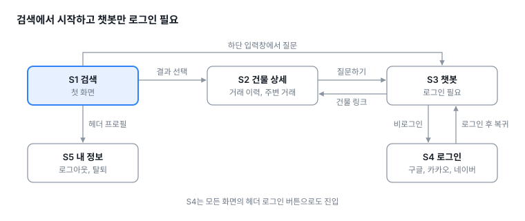

## 2. S1 검색

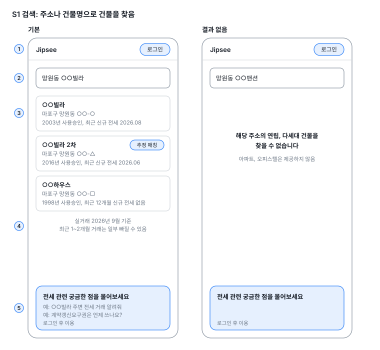

### 구성

| 번호 | 요소        | 내용                                                                                    |
| ---- | ----------- | --------------------------------------------------------------------------------------- |
| 1    | 헤더        | 서비스명과 로그인 버튼을 표시함. 로그인하면 프로필로 바뀜                               |
| 2    | 검색창      | 도로명 주소, 지번 주소, 건물명을 입력함                                                 |
| 3    | 결과 목록   | 건물명, 주소, 사용승인 연도, 최근 신규 전세 계약 월을 표시함. 결과를 누르면 S2로 이동함 |
| 4    | 기준일      | 실거래 기준 월과, 최근 1\~2개월 거래가 누락될 수 있다는 안내를 표시함                   |
| 5    | 챗봇 입력창 | 예시 질문을 표시함. 로그인하지 않았으면 S4로 이동함                                     |

### 유저 플로우

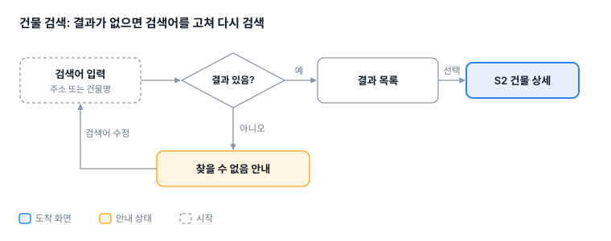

## 3. S2 건물 상세

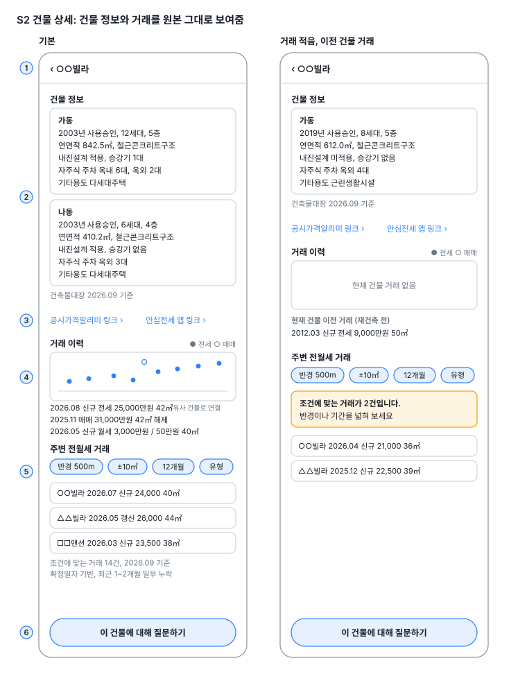

### 구성

| 번호 | 요소             | 내용                                                                                                                                                                                                                                                                                                                             |
| ---- | ---------------- | -------------------------------------------------------------------------------------------------------------------------------------------------------------------------------------------------------------------------------------------------------------------------------------------------------------------------------- |
| 1    | 헤더             | 뒤로 가기와 건물명을 표시함                                                                                                                                                                                                                                                                                                      |
| 2    | 건물 정보        | 동마다 동 명칭, 사용승인 연도, 세대수, 층수, 연면적, 구조, 내진설계, 승강기, 주차 대수, 기타용도를 표시하고, 건축물대장 기준 월을 표시함. 원본 값이 0이거나 비어 있으면 숨기고, 승강기만 0이면 "없음"을 표시함                                                                                                                   |
| 3    | 외부 링크        | 공시가격알리미 링크와 안심전세 앱 링크를 표시함                                                                                                                                                                                                                                                                                  |
| 4    | 거래 이력        | 계약 월별 점 그래프와 거래 목록을 표시함. 월세의 보증금과 월세는 거래 목록에만 표시함                                                                                                                                                                                                                                            |
| 5    | 주변 전월세 거래 | 반경은 300m, 500m, 1km 중에서 고르며 기본값은 500m임. 면적 조건은 현재 건물 거래(이전 건물 거래 제외)의 전용면적 최솟값보다 10㎡ 작은 값부터 최댓값보다 10㎡ 큰 값까지로 고정하며, 사용자가 바꿀 수 없음. 현재 건물 거래가 없으면 면적 조건 없이 조회함. 기간은 6개월, 12개월, 24개월 중에서 고르며 기본값은 12개월임. 거래 유형은 전세와 월세 중에서 고르며 기본값은 전세임. 월세 거래에는 보증금과 월세를 표시함. 건물 좌표가 없으면 "이 건물은 위치 정보가 없어 주변 거래를 보여드릴 수 없습니다."를 표시함 |
| 6    | 질문하기         | S3로 이동함. 로그인하지 않았으면 S4로 이동함                                                                                                                                                                                                                                                                                     |

### 유저 플로우

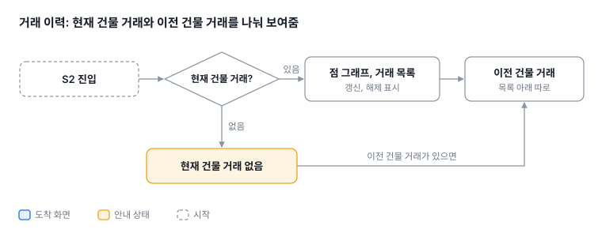

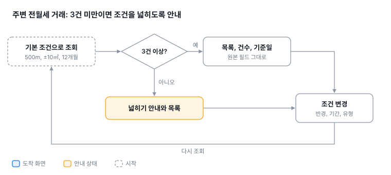

## 4. S3 챗봇

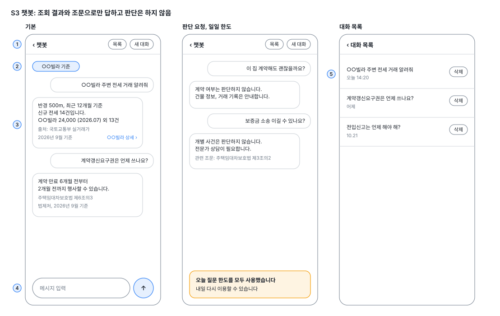

### 구성

| 번호 | 요소      | 내용                                                                                                                       |
| ---- | --------- | -------------------------------------------------------------------------------------------------------------------------- |
| 1    | 헤더      | 뒤로 가기, "챗봇", 대화 목록 버튼, 새 대화 버튼을 표시함                                                                   |
| 2    | 건물 칩   | S2에서 들어오면 해당 건물로 새 대화를 시작하며, 건물이 자동으로 입력됨                                                     |
| 3    | 답변      | 답변을 스트리밍으로 표시함. 답변에 나온 건물 이름을 누르면 S2로 이동함                                                     |
| 4    | 입력창    | 답변이 나오는 중에는 전송을 막음                                                                                           |
| 5    | 대화 목록 | 지난 대화의 제목과 마지막 메시지 시각을 최근 순으로 표시함. 대화를 누르면 이전 메시지를 불러와 이어서 질문할 수 있음. 확인을 거친 뒤 대화를 삭제할 수 있음 |

### 유저 플로우

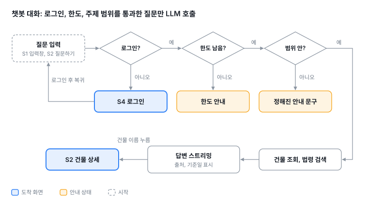

## 5. S4 로그인, S5 내 정보

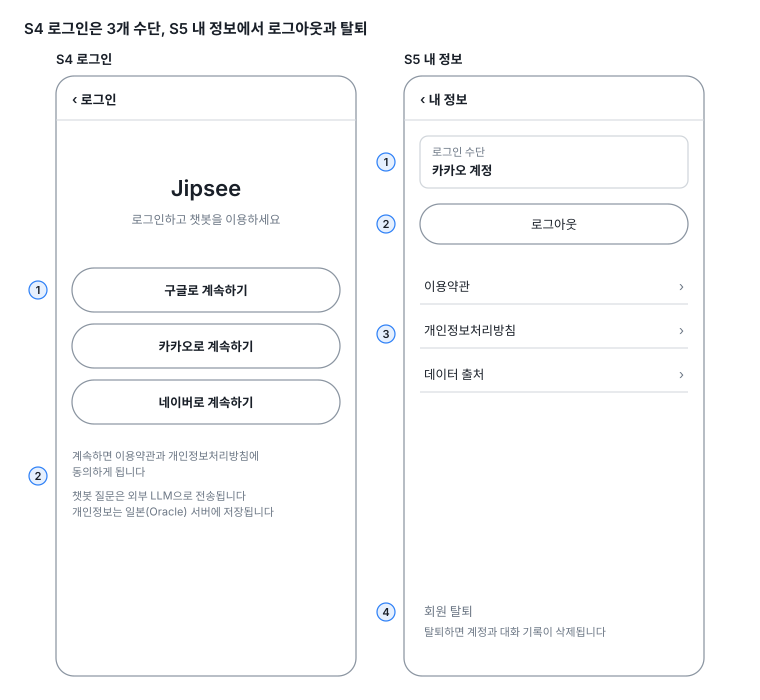

### S4 로그인

| 번호 | 요소        | 내용                                                                                                                  |
| ---- | ----------- | --------------------------------------------------------------------------------------------------------------------- |
| 1    | 로그인 버튼 | "구글로 계속하기", "카카오로 계속하기", "네이버로 계속하기"를 표시함                                                  |
| 2    | 고지        | 이용약관과 개인정보처리방침 링크를 표시함. 챗봇 질문이 외부 LLM으로 전송됨과 개인정보가 일본으로 국외 이전됨을 안내함 |

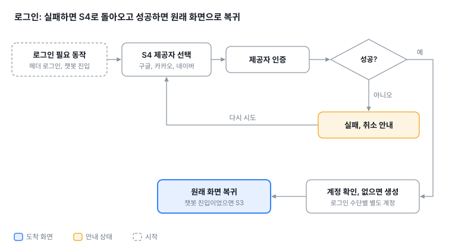

### S5 내 정보

| 번호 | 요소        | 내용                                                  |
| ---- | ----------- | ----------------------------------------------------- |
| 1    | 로그인 수단 | 현재 로그인한 제공자를 표시함                         |
| 2    | 로그아웃    | 로그아웃하면 S1로 이동함                              |
| 3    | 정책        | 이용약관, 개인정보처리방침, 데이터 출처 링크를 표시함 |
| 4    | 회원 탈퇴   | 확인을 거친 뒤 계정과 대화 기록을 삭제함              |

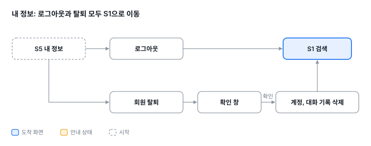

## 6. S6 정책

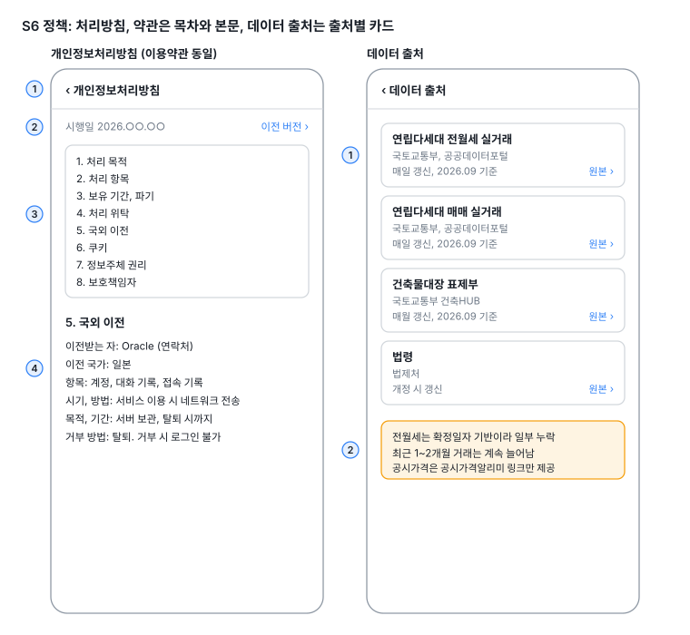

### 구성

| 번호          | 요소      | 내용                                                                                               |
| ------------- | --------- | -------------------------------------------------------------------------------------------------- |
| 1             | 헤더      | 뒤로 가기와 문서명을 표시함                                                                        |
| 2             | 시행일    | 시행일과 이전 버전 목록을 표시함                                                                   |
| 3             | 목차      | 목차의 항목을 누르면 본문의 해당 항목으로 이동함                                                   |
| 4             | 본문      | 항목별 내용을 표시함                                                                               |
| 데이터 출처 1 | 출처 카드 | 데이터명, 제공 기관, 갱신 주기, 현재 기준 월, 원본 링크를 표시함                                   |
| 데이터 출처 2 | 한계 안내 | 확정일자 기반이라 거래가 누락될 수 있고 공개가 지연될 수 있으며, 공시가격은 링크만 제공함을 안내함 |

### 유저 플로우

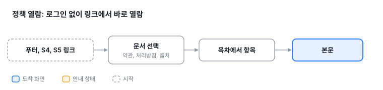

### 개인정보처리방침 항목

| 항목             | Jipsee 내용                                                                                                                       |
| ---------------- | --------------------------------------------------------------------------------------------------------------------------------- |
| 처리 목적        | 회원 식별, 챗봇 제공, 요청 제한, 부정 이용 방지                                                                                   |
| 처리 항목        | 로그인 제공자, 제공자 사용자 ID, 챗봇 대화 내용, 접속 IP, 접속 기록                                                               |
| 보유 기간, 파기  | 계정은 탈퇴할 때까지 보관함. 대화 기록은 사용자가 삭제하거나 탈퇴할 때까지 보관함. 접속 기록의 보관 기간은 미정임. 탈퇴하면 즉시 삭제하고, 백업에 남은 정보는 7일 뒤 삭제함 |
| 처리 위탁        | Oracle(서버), Cloudflare(CDN, 봇 차단), LLM 제공사(미정), Sentry(오류 추적)                                                       |
| 국외 이전        | 이전받는 자별로 법적 근거, 항목, 국가, 시기와 방법, 연락처, 목적과 보유 기간, 거부 방법과 효과를 기재함                           |
| 쿠키             | 로그인 세션 쿠키를 사용함. 쿠키를 거부하면 로그인할 수 없음                                                                       |
| 정보주체 권리    | 열람, 정정, 삭제, 처리정지를 요청하는 방법을 기재함. 탈퇴는 S5에서 할 수 있음                                                     |
| 안전성 확보 조치 | HTTPS, 서버 접근 제한, 비밀값 분리                                                                                                |
| 보호책임자       | 운영자 이름, 연락 이메일                                                                                                          |
| 변경             | 시행일을 기재하고 이전 버전을 보관함                                                                                              |

### 이용약관 항목

| 항목        | Jipsee 내용                                                                                       |
| ----------- | ------------------------------------------------------------------------------------------------- |
| 서비스 내용 | 공공데이터 조회와 챗봇을 제공함. 계산, 판단, 법률 자문은 제공하지 않음                            |
| 회원        | 구글, 카카오, 네이버 로그인으로 가입함. 탈퇴는 S5에서 할 수 있음                                  |
| 이용 제한   | 자동화 수집, 요청 제한 초과, 지시 조작 시도가 있으면 이용을 제한함                                |
| 데이터 한계 | 원본을 그대로 제공함. 누락이나 공개 지연이 있을 수 있고, 유사 건물로 연결된 거래가 포함될 수 있음 |
| 챗봇        | 답변은 일반 정보임. 외부 LLM을 사용함. 일일 한도가 있음                                           |
| 책임        | 무료 서비스임. 정보 이용 결과에 대한 책임 범위를 기재함                                           |
| 변경, 분쟁  | 변경하면 사전에 공지함. 준거법은 대한민국 법임                                                    |

### 데이터 출처 항목

| 데이터                   | 제공 기관                  | 갱신               | 비고                            |
| ------------------------ | -------------------------- | ------------------ | ------------------------------- |
| 연립다세대 전월세 실거래 | 국토교통부, 공공데이터포털 | 매일               | 이용허락범위를 확인한 뒤 표기함 |
| 연립다세대 매매 실거래   | 국토교통부, 공공데이터포털 | 매일               | 이용허락범위를 확인한 뒤 표기함 |
| 건축물대장 표제부        | 국토교통부 건축HUB         | 매월               |                                 |
| 법령                     | 법제처                     | 개정될 때          |                                 |
| 좌표                     | 지오코딩 서비스(미정)      | 표제부를 적재할 때 |                                 |
| 공시가격                 | 공시가격알리미             |                    | 링크만 제공함                   |

## 7. 공통

| 항목           | 내용                                                              |
| -------------- | ----------------------------------------------------------------- |
| 헤더           | 서비스명을 누르면 S1로, 프로필을 누르면 S5로 이동함               |
| 푸터           | 데이터 출처, 이용약관, 개인정보처리방침 링크를 표시함             |
| 요청 제한 초과 | "요청이 많습니다. 잠시 후 다시 시도해 주세요"를 표시함            |
| 봇 차단        | 평소에는 보이지 않고, 요청이 의심될 때만 확인을 표시함            |
| 오류           | "일시적인 오류가 발생했습니다"를 표시하고, 다시 시도할 수 있게 함 |
